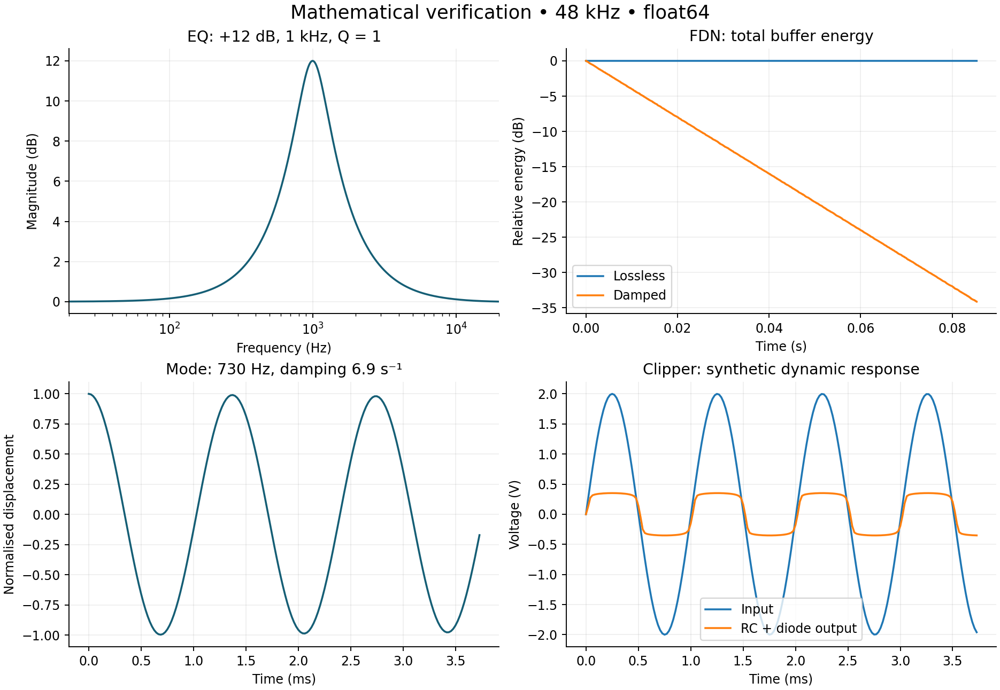

# Phases, validation and experiments

> Generated view of [research-and-plans.md](research-and-plans.md), the canonical source. Edit the report and run `python docs/plan/verification/build_views.py`. R/S IDs refer to the complete report’s bibliography.

<a id="7-phases"></a>

## 7. Phases, dependencies and deliverables

### 7.1 Learning and implementation contract

Each FX card is a study and engineering plan. Completion requires six artefacts:

1. **Derivation:** system diagram, assumptions, units, continuous equations or DSP definition; explicitly eliminate variables and identify states, inputs and outputs.
2. **Discretisation:** derive the recurrence, stability, causality, error and parameter-change policy. Explain what reduction discards.
3. **Independent reference:** offline implementation with higher precision or a different numerical method; publish inputs and parameters.
4. **Experiments:** predict results before execution; vary one parameter at a time and compare time, frequency and, where applicable, energy responses.
5. **RT implementation:** preallocated state, bounded work, events, reset, latency, tail, failure handling and reference comparisons.
6. **Dossier:** figures, audio, metrics, limitations, references and code/data provenance, identifying the approved operating domain.

The implementer should explain every state, calculate a limiting case by hand, predict parameter changes and distinguish discretisation error from identification error. Compiling an audible plug-in does not satisfy this gate.

### 7.2 Proposed sequence

[phases.yaml](phases.yaml) is the machine-readable dependency and coverage list. Implementation nodes start as `pending`. The research and section 11 experiments are delivered; the engine is not yet implemented.

| Phase | Inputs | Work and reviewable output | Exit gate |
| --- | --- | --- | --- |
| P00 — Conventions and corpus | This report | Units, calibration, deterministic signals, source manifest and operating limits | Every parameter has units, range and meaning |
| P01 — Core and graphs | P00 | C++20 API, buffers, events, mixing, bypass, feedback and latency policy | Block partition equivalence unless explicitly excluded |
| P02 — Filters and control | P00 | Biquads, SVF/TPT, envelopes, LFO and parameter interpolation | Reference agreement and stability in the approved domain |
| P03 — Delays and resampling | P01 | Ring buffers, fractional taps, Farrow, crossfades and resampler | Measured delay/magnitude error and safe read bounds |
| P04 — Circuits and antialiasing | P01, P02 | MNA/WDF, Newton, ADAA, oversampling and failure modes | RC equivalence, residual/convergence and alias measurements |
| P05 — Modes and acoustic networks | P01, P02, P03 | Modal bank, FDN, energy and losses | Poles, passive conservation and controlled decay |
| P06 — FFT, convolution and STFT | P01 | FFT, partitioning, windows and overlap-add | Direct convolution equivalence and STFT reconstruction |
| P07 — Temporal modulation | P02, P03 | FX01, FX04–FX09, FX26, FX29 | Explained combs, sidebands, pitch and buffer boundaries |
| P08 — Musical filters | P02, P04 | FX10, FX11 | Static/automated curves; tone stack against circuit |
| P09 — Dynamics | P02, P04, P08 | FX12–FX15 | Static curve, transients and sidechain; separate optical model |
| P10 — Nonlinearity and amplification | P04, P08 | FX16–FX18 | Harmonics, IMD, memory, levels and electroacoustic comparison |
| P11 — Tape and BBD | P03, P04, P07 | FX02, FX03 | Transport/clock distinguished from saturation/filtering |
| P12 — Reverberation | P05, P06 | FX19–FX23 | Decays, reflections and modes; physical plate/spring parameters |
| P13 — Space and resonators | P05, P06, P07, P12 | FX24, FX30 | Motion, orientation, symmetry, modal projection and energy |
| P14 — Pitch, source–filter and spectrum | P03, P06, P07 | FX25, FX27, FX28, FX31 | Reconstruction, transients, latency and artefacts |
| P15 — Composition and identification | P09, P10, P11, P12, P13, P14 | FX32, presets and gray-box comparison | Generalisation to held-out levels, controls and sample rates |
| P16 — Integration and release | P15 | Hosts, listening, CPU, documentation and licence inventory | Common/family gates passed and limitations published |

Physical FX06/FX08 variants additionally depend on P04; the YAML records these variant dependencies. Dependencies require available infrastructure, not completion of every family variant before research elsewhere begins. A useful first demonstration follows P00–P03 with delay, EQ, flanger, chorus and signal-domain dynamics, then P05 for FDN. The full circuit-inclusive P08/P09 phases do not prevent this smaller initial DSP slice.

### 7.3 Routes to deep understanding

| Route | Study sequence | Question the final dossier must answer |
| --- | --- | --- |
| Propagation and modulation | N01–N03 → N05 → FX01 → FX04/05 → FX02/03 → FX24 | How does geometry/time variation become phase, Doppler and sidebands? |
| Circuits and energy | N02–N04 → FX10/11 → FX16 → N06 → FX08/14/17 | Which approximation changes loading, feedback, memory and aliasing? |
| Amplitude control | N01/N08 → FX12 → FX15 → FX13/14 | Why do compressors with the same ratio have different transients? |
| Acoustics and reverberation | N07 → FX30 → FX19/20 → FX21 → FX22/23 | Which geometry and dispersion information survives each reduction? |
| Time–frequency | N02 → FX20 → FX28 → FX25/26/27/31 | Which phase information is lost, and what happens to transients? |
| Identification and hybrids | Selected baseline models → FX32 | Does a good fit identify physics or only input/output behaviour? |

### 7.4 Execution card for a concrete model

Use this format for each specific variant:

```yaml
model_id: FX16-diode-rc-v1
status: pending
source_ids: [R06, R12, R13]
physical_system: resistor, capacitor and antiparallel diodes
assumptions: ideal source; no diode junction capacitance
parameters_with_units: [R_ohm, C_farad, Is_ampere, eta_dimensionless, VT_volt]
state: [capacitor_voltage_volt]
continuous_model: docs/model/diode-rc-derivation.md
discrete_model: implicit trapezoidal
oracle: adaptive ODE with tolerance and convergence sweep
stimuli: [dc_sweep, sine_levels, two_tone, burst, silence]
acceptance: approved-domain accuracy plus bounded solver work
artifacts: [derivation, oracle, measurements, audio, realtime, limitations]
```

Paths in this illustrative card are future deliverables, not existing files. Estimate implementation effort after prototyping each numerical kernel. Hardware identification and measurement access can dominate the schedule.

<a id="8-validation"></a>

## 8. Validation, measurements and acceptance criteria

### 8.1 Four separate questions

**Is the equation correct?** Check units, signs, boundary conditions, conservation, limiting cases and an independent derivation. **Does the recurrence solve it?** Study step/order convergence and compare a different solver. **Does the equation represent the object?** Compare measurements excluded from identification. **Does the effect work as a product?** Test latency, automation, operational stability, CPU and listening.

Two translations of the same implementation do not independently validate the equation. A listening demonstration does not establish numerical accuracy or identification. Phase differences can make samplewise error large without equivalent perceptual differences; measure both.

### 8.2 Test matrix and initial targets

These values are **proposed gates**, not measured engine results. Record the tested domain and adjust criteria before approving each concrete model.

| Test | Method | Initial target / decision |
| --- | --- | --- |
| LTI filters | Impulse and complex response against analytic solution | Relative L2 error < 1e-10 in float64 away from singularities; float32 tolerance based on conditioning |
| Musical EQ | Frequency/Q/gain/sample-rate grid | Magnitude error < 0.1 dB in declared band; also report phase |
| Nonlinear solver | Scaled residual and independent integration | Reference residual < 1e-8; RT iteration ceiling and documented fallback |
| Time convergence | Repeat at T, T/2 and T/4 | Expected order in smooth regimes; evaluate discontinuities separately |
| Aliasing | Coherent sine, multisine and drive sweep | Compare 1×/2×/4×/8× with a converged reference; approve per-mode dBFS limits |
| Delay | Impulse, sine and read-position ramps | Exact integer delay; published fractional-delay error curves |
| Reverb | Bandwise EDC, modes, echo density, autocorrelation | Requested T60 within ±5% where estimator dynamic range is sufficient |
| Plate/spring | Poles and IR against refined solver/measurement | < 1% modal-frequency error in the included domain; weights/decays separately assessed |
| Compressor | Static sweep and calibrated steps | Static curve within 0.1 dB of model; identical timing definitions |
| STFT | Identity, shifted impulses and tones | Float64 relative error < 1e-10 after alignment and documented edges |
| Convolution | Direct versus partitioned FIR | Numerical equivalence after latency alignment; race-free IR replacement |
| RT | 32/64/128/256/512 samples; 44.1/48/88.2/96 kHz | No callback allocations/locks; maximum and percentile CPU, not only mean |
| Automation | Steps, ramps, topology changes and bypass | No NaN/Inf; bounded states; measured control artefacts and latency |
| Robustness | Silence, DC, denormals, overload, reset, invalid values | Deterministic policy and no out-of-bounds access |

Normalised waveform error is $\|y-\hat y\|_2/(\|y\|_2+\epsilon)$. Do not use it alone for diffuse reverbs, pitch processing or stochastic algorithms. Aliasing measurements must distinguish spurious bins from leakage, legitimate harmonics and intended modulation. A 16× reference is trustworthy only when further refinement establishes sufficient convergence.

### 8.3 Independent references by family

- **Circuits:** schematic → independently derived MNA equations → ngspice with published device models/tolerances. Differences between detailed SPICE devices and simplified equations are part of the diagnosis.
- **Filters:** analytic poles/zeros/response; SVF/TPT against a separately transformed continuous transfer function.
- **Objects:** analytic modes with known normalisation, then refined FEM/FDTD and measurements. Check force units, modal mass and transducer positions.
- **FDN:** matrix identities and total buffer energy with no input. A particular output may rise through interference while total energy decreases.
- **Convolution/STFT:** direct summation and reconstruction; separate algorithm, scheduling and host-reported latency.
- **Identification:** distinct training, validation and test stimuli, including unseen control combinations. A low-level IR cannot identify saturation or hysteresis.

### 8.4 Listening and reproducibility

Keep dry, processed and residual lossless audio without destructive normalisation. Character comparisons should control loudness and latency; dynamics comparisons should preserve relevant gain differences and document the protocol. Use musical and synthetic material, multiple levels and adverse cases. Controlled listening with participants needs its own protocol and analysis; no listening results are claimed here.

Each run records seed, dependency/compiler versions, commit, sample rate, block size, CPU/OS, parameters, tolerances and data hashes. CPU figures from different machines are not directly interchangeable. Publish failures and operating boundaries alongside successful presets.

<a id="11-experiments"></a>

## 11. Reproducible mathematical experiments

[verification/check_models.py](verification/check_models.py) runs 12 float64 checks with synthetic signals and a fixed seed. Complete results, versions and individual test scope are in [results.json](verification/results.json); the compact table is in [results.md](verification/results.md). These validate selected equation cases, not an already implemented engine or real hardware emulation.

```bash
python -m pip install -r docs/plan/verification/requirements.txt
python docs/plan/verification/check_models.py
python docs/plan/verification/check_plan.py
```

| Experiment | Verified relation | Learning objective / limitation |
| --- | --- | --- |
| 1. RBJ EQ | Centre and endpoint gains across 81 designs | Gain conventions and coefficients; static controls |
| 2. TPT SVF | Recurrence versus bilinear continuous transfer | States and prewarping; nine cases |
| 3. WDF RC | Wave relation versus independent bilinear filter | Capacitor reflection sign and port resistance |
| 4. Feedback delay | Ring-buffer impulse drops 60 dB after 1 s | Loss per traversal, not per output sample |
| 5. Frozen flanger | Analytic nulls versus FIR response | Interference; no LFO or varying interpolation |
| 6. FDN | Total unforced buffer energy | Orthogonal conservation and damping; fixed delays |
| 7. Modal oscillator | Matrix exponential versus closed form | Damped frequency, states and energy |
| 8. Plate | Quadrature modal mass and geometry scaling | Force normalisation; simply supported, no tension |
| 9. Diode RC | Safeguarded Newton versus Brent | Unique implicit root; not hardware or continuous-time accuracy |
| 10. Linear ADAA | Antiderivative difference versus two-sample average | First-order ADAA changes even linear response |
| 11. Convolution | FFT overlap-add versus direct sum | Tail and short last block; no RT scheduler |
| 12. STFT | Analysis/synthesis with window normalisation | Reconstruction and edges; not a modified phase vocoder |



The same script generates these plots: EQ response, total FDN energy, a damped mode and RC clipper voltage. All data are synthetic model outputs. To deepen understanding, change one parameter, first write an analytic prediction, rerun and explain deviations. Then add the continuous-time reference, identification and RT tests prescribed by the component plan.

**Delivery status:** research and plans available; v0.1 now implements the core and all 32 family baselines, with compiled tests and independent numerical comparisons. See the [implementation report](../implementation/README.md) for exact coverage and remaining variants. YAML statuses distinguish the delivered core from unfinished physical extensions and product gates.
