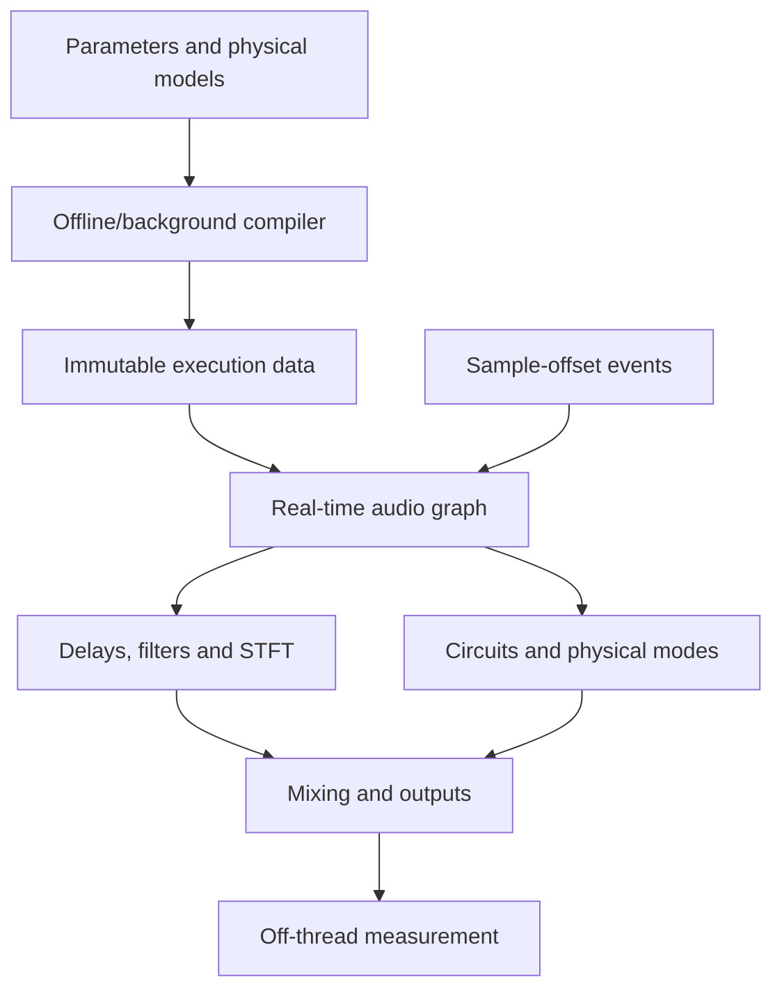

# Physical Modelling of Audio Effects

## Research, mathematical specification and implementation plans

**Prepared for Guilherme da Silveira · 11 October 2026 · Version 1.1**

**Scope:** a modular, real-time audio effects engine covering physical models, virtual analog models and signal-processing effects. This self-contained study and implementation document provides 32 component/family plans, shared mathematical foundations, implementation phases, acceptance criteria and an annotated bibliography.

## Contents

1. [Decisions and relationship to the reference project](#1-decisions)
2. [Coverage and taxonomy](#2-coverage)
3. [Research findings and choices](#3-research)
4. [Mathematical and numerical foundations](#4-foundations)
5. [Plans for 32 component families](#5-components)
6. [Architecture and contracts](#6-architecture)
7. [Phases, dependencies and deliverables](#7-phases)
8. [Validation, measurements and acceptance criteria](#8-validation)
9. [Engineering risks and decisions](#9-risks)
10. [Bibliography and software](#10-sources)
11. [Reproducible mathematical experiments](#11-experiments)

<a id="1-decisions"></a>

## 1. Decisions and relationship to the reference project

### 1.1 Recommended outcome

Build **an effects graph with several numerical kernels**. Some effects are fundamentally delay lines; others are nonlinear differential circuits, wave fields, modal banks or time–frequency transformations. Unify their interfaces, units, events, measurement and validation rather than forcing every effect into one solver.

Physical models should expose interpretable parameters: resistance, capacitance, geometry, thickness, tape speed, magnetic field, impedance and absorption. Signal effects should expose their own parameters: frequency, Q, compression ratio, window, hop, semitones and resolution. A control called “material” should exist only if it actually changes a physical model or an explicitly identified empirical mapping.

**Proposed choices:** C++20 for the engine independently of plug-in format; Python/NumPy/SciPy for reference models and identification; WDF or MNA for circuits; modal states for vibrating objects; delays/FDNs for approximate propagation and efficient reverberation; convolution for measured linear systems; STFT for spectral effects; neural models as comparative alternatives or identified hybrid components.

### 1.2 Reference analysed

Repository: [gbasilveira/plucked-physical-modeling-engine](https://github.com/gbasilveira/plucked-physical-modeling-engine).

Inspected snapshot: `49b00478e0fb5f90aea2411471d72f2ef69cbed7`. The inspected tree contains planning documentation; its README states that implementation has not begun. The review covered the README, planning index, literature survey, implementation plan and structural sections of the engine specification and phasing plan.

| Reference element | Equivalent in this report |
| --- | --- |
| `literature-survey.md` | Sections 3 and 10: literature, software, usefulness and limitations |
| `engine-specification.md` | Sections 4–6: equations, discretisation, execution and contracts |
| `implementation-plan.md` | Sections 1, 6 and 9: architecture, costs and decisions |
| `phasing-plan.md` | Section 7: phases with inputs, outputs and gates |
| `verification/` | Sections 8 and 11: independent references and reproducible experiments |
| `phases.yaml` | Machine-readable dependency graph and standard model card |

This work does not modify the reference repository. It preserves its useful separation: the specification governs behaviour, while phases govern deliverables and tests. Piano-specific choices do not automatically transfer to effects. In particular, adding a sub-block of latency inside analog feedback changes the circuit, even if it simplifies parallel execution.

### 1.3 Levels of claim

- **Physics:** a conservation, constitutive or propagation law, with units and assumptions.
- **Reduction:** a declared approximation of a more complex system, such as truncated modes or a variable-resistor JFET approximation.
- **Signal DSP:** a useful transformation without a claim to represent a particular physical object.
- **Proposal:** architecture, exercises and thresholds recommended here; these are not published results or measured performance of the future engine.

The baseline models below are implementable. Emulating a particular device also requires its circuit or mechanical design, parameter values and measurements. The plans identify that work explicitly: a generic valve equation is not a verified emulation of every amplifier.

<a id="2-coverage"></a>

## 2. Coverage and taxonomy

“All” is interpreted as coverage of the principal audio transformation families and their compositions. There is no finite list of every possible effect: new effects arise through composition, control and feedback. This table makes the scope auditable.

| ID | Family and included variants | Main nature | Kernels |
| --- | --- | --- | --- |
| FX01 | Delay, echo, slapback, multitap, ping-pong, dub | Signal / propagation | Delay, feedback matrix |
| FX02 | Tape delay, tape saturation, wow/flutter, multihead | Physics + reduction | Transport, hysteresis, filters |
| FX03 | BBD delay and analog ensemble | Sampled circuit | Clock, sample-and-hold, filters |
| FX04 | Flanger, through-zero, positive/negative feedback | Interference | Variable delay |
| FX05 | Chorus, doubler, ensemble, vibrato, ADT | Signal / transport | Multiple delays, modulation |
| FX06 | Phaser, allpass, JFET/OTA phaser | Signal / circuit | Allpass, WDF/MNA |
| FX07 | Tremolo, harmonic tremolo, autopan, chopper | Modulation | Gain, LFO, crossover |
| FX08 | Ring modulation, AM, diode ring | Signal / circuit | Multiplication, nonlinearities |
| FX09 | Frequency shifter, composed barber-pole effects | Signal | Quadrature, Hilbert transform |
| FX10 | Parametric/graphic EQ, shelves, tilt, notch, FIR, tone stack | Signal / circuit | Biquads, FIR, MNA |
| FX11 | Wah, autowah, envelope filter, ladder, SVF, resonant LP/HP/BP | Circuit / control | TPT, WDF, nonlinear solver |
| FX12 | Compressor, limiter, expander, gate, ducking, multiband | Signal / control | Detector, gain computer, lookahead |
| FX13 | Optical compression and vactrol | Physics + identification | Photoconductivity, slow states |
| FX14 | FET, VCA, vari-mu and feedback compression | Circuit | JFET, valve, sidechain |
| FX15 | Transient shaper, de-esser, dynamic EQ | Adaptive signal processing | Envelopes and bands |
| FX16 | Overdrive, distortion, fuzz, clipper, rectifier, wavefolder, exciter | Circuit / signal | WDF/MNA, ADAA |
| FX17 | Amplifier, preamp, power amp, transformer, sag | Circuit physics | DAE, magnetism, power supply |
| FX18 | Speaker, cabinet, microphone and pickup transfer | Electroacoustics / measurement | ODE, IR, modes |
| FX19 | Algorithmic reverb: Schroeder, Dattorro, FDN, shimmer, freeze | Signal / approximation | Delay networks |
| FX20 | Convolution reverb and filtering, IR morphing | Measured linear system | Partitioned FIR |
| FX21 | Room, hall, chamber, early reflections, room modes | Acoustics | Image-source, SDN, FDTD/FEM |
| FX22 | Plate reverb and two-dimensional objects | Mechanics | Plate PDE, modes |
| FX23 | Spring reverb and helical dispersion | Mechanics | Helical, allpass/modal models |
| FX24 | Spatialisation, binaural, Ambisonics, rotary/Leslie, Doppler, widening | Acoustics / signal | Geometry, HRTF, delays |
| FX25 | Pitch shifter, harmoniser, octave, tuning correction, time stretch, formants | Signal | Delays, STFT, PSOLA/WSOLA |
| FX26 | Granular, reverse, stutter, buffer freeze, glitch | Segmented signal | Buffers and windows |
| FX27 | Vocoder, talkbox, formant filters, cross-synthesis | Source–filter / acoustics | Filterbanks, LPC, tubes |
| FX28 | Spectral delay, spectral freeze, morph, blur, spectral gate | Time–frequency | STFT, per-bin filters |
| FX29 | Bitcrusher, sample-rate reduction, lo-fi, vinyl/radio/telephone | Signal / degradation | Quantisation, resampling, noise |
| FX30 | Resonators and objects excited by audio | Mechanics / acoustics | Modes, waveguides, coupling |
| FX31 | Denoise, de-click, de-hum, dereverb and inverse filters | Estimation / restoration | Spectral statistics, regularisation |
| FX32 | Multi-FX, parallel and feedback graphs, hybrid convolution, neural assistance | Composition | Graph, stability, identification |

Analysis tools, meters and tuning measurement are infrastructure, not a 33rd effects family. Semantic source separation, music generation and complete codecs are adjacent areas, not specified as engines in this version. Codec degradation can become an FX29 node, but requires a codec-specific specification.

<a id="3-research"></a>

## 3. Research findings and choices

### 3.1 The most useful research strands

**DAFx and virtual analog.** The DAFx archive connects device descriptions to component models. Work by Holters, Zölzer, Yeh, Werner, Parker, Bernardini and collaborators is useful for circuits, WDFs, nonlinear reduction and analog sampling models. See [R04–R12], [R24–R28].

**Acoustics and structures.** Bilbao and Parker address spring dispersion and numerical difficulties; Bilbao, Arcas, Chaigne, Ducceschi and Webb address plates. For rooms, SDN and FDN literature distinguishes geometric approximation from perceptual quality. See [R14–R22].

**Libraries as executable documentation.** Faust provides small inspectable building blocks. `chowdsp_wdf` connects WDF formulations to C++. `fdnToolbox` supports research and should not be mistaken for a permissively licensed product dependency. `ngspice` supplies an independent circuit reference. See [S01–S06], [S12].

**Identification and differentiable models.** The model comparison in [R29] and sample-rate work in [R30] help assess where neural methods are useful. Matching a waveform does not necessarily allow resistances, geometry or materials to be changed meaningfully.

### 3.2 Reading selection by technical value

| Reading | Contribution | Practical decision |
| --- | --- | --- |
| DAFx, second edition [R01] | Broad taxonomy and connections between families | Use as a map, not a single specification |
| Smith, Physical Audio Signal Processing [R02] | Delays, scattering, waveguides and resonance | Develop intuition for propagation and feedback |
| Zavalishin [R03] | Topology-preserving VA filter design | Derive SVF/TPT before copying coefficients |
| EQ Cookbook and EQ review [R04–R05] | Biquads and alternative equalisation methods | Separate functional EQ from device-specific circuits |
| Holters–Parker BBD [R08] | Variable sampling and input/output filters | Do not reduce BBD modelling to a darkened delay |
| Chowdhury, tape [R09] | Magnetisation connected to audio processing | Treat hysteresis as state, not `tanh` |
| Phaser 2014 and 2024 [R10–R11] | Nonlinear circuit versus variable JFET reduction | Measure the reduction's valid operating region |
| ADAA 2016 and WDF/ADAA 2021 [R12–R13] | Aliasing reduction and changes to dynamics | Derive ADAA jointly with feedback |
| Lossless FDNs [R15] | Network energy structure | Use orthogonal mixing with controlled losses |
| SDN 2015 / RARN 2024 [R17–R18] | Geometry without full-field simulation cost | Starting point for editable rooms |
| Spring 2010/2013 [R21–R22] | Dispersive waves and multiple branches | Retain a physical reference when fitting reductions |
| Compressor tutorial / Fairchild / vactrol [R23–R25] | Dynamic control and physical gain elements | Maintain separate models and validation suites |

### 3.3 Recent work worth prototyping

**2024 — WDF phaser with a JFET resistance approximation [R11].** Supplementary material includes MATLAB, LTspice and a plug-in. This provides a useful comparison between an efficient reduction and circuit simulation. Small channel voltage is part of the approximation; it does not establish overload fidelity.

**2025 — ADAA through lookup-table integration [R31].** This supports curves without convenient symbolic antiderivatives. Compare table interpolation error, cancellation, memory use and aliasing against analytic alternatives.

**2025 — Black-box/gray-box comparison and ToneTwist AFx [R29].** Useful for benchmarking several device classes and studying control conditioning. Learned parameters are not automatically identifiable physical quantities.

**2025 — Stability during RNN control changes [R32].** This work examines artefacts introduced by time-varying controls. Include silence with aggressive automation in tests of neural nodes; static audio error does not cover that case.

**2026 — Parameter Estimation via Differentiable Modal Plate Synthesis [R33].** The DAFx26 challenge paper studies parameter estimation from synthetic IRs. Its evaluation on eight synthetic IRs is a useful inverse-problem experiment, not evidence of universal material recovery from real recordings. Investigate identifiability separately.

### 3.4 Evidence policy

Technical sources are papers, author publications, official documentation and original repositories. The bibliography distinguishes consulted technical text, abstract/metadata and software documentation. Third-party products were not comprehensively audited or executed. Search indexing dates were not treated as publication dates. Architecture and acceptance thresholds are proposals; original numerical experiments are explicitly identified.

<a id="4-foundations"></a>

## 4. Mathematical and numerical foundations

<a id="n01"></a>

### N01 — Conventions, units and calibration

Use $f_s$ in Hz, $T=1/f_s$ in seconds and $n$ as the sample index. Digital frequency is $\omega=2\pi f/f_s$ in rad/sample; continuous-time frequency is $\Omega=2\pi f$ in rad/s. $z^{-1}$ denotes one sample of delay.

Normalised audio $x[n]$ is not a voltage. A circuit receives $v_{in}=V_{ref}x[n]$ and returns $y=v_{out}/V_{out,ref}$. Calibration factors belong in the preset. Without them, “6 dB drive” does not specify the diode voltage and comparisons between models become ambiguous.

For amplitude, $G=10^{g_{dB}/20}$; for power, $P_2/P_1=10^{g_{dB}/10}$. State whether a detector measures peak, RMS, power or logarithmic level. An amplitude decay $e^{-\sigma t}$ has $T_{60}=\ln(1000)/\sigma$. Energy decays as $e^{-2\sigma t}$, but its dB conversion uses 10 rather than 20.

Separate artistic level from physical level. A mix parameter must not silently change the amplitude driving a nonlinearity. Serialised state records reference sample rate, units, calibration and model version.

<a id="n02"></a>

### N02 — Linear systems: transfer functions and state

A causal linear time-invariant system satisfies:

$$y[n]=\sum_{k=0}^{\infty}h[k]x[n-k].$$

A second-order IIR realisation is:

$$H(z)=\frac{b_0+b_1z^{-1}+b_2z^{-2}}{1+a_1z^{-1}+a_2z^{-2}},\quad
y[n]=b_0x[n]+b_1x[n-1]+b_2x[n-2]-a_1y[n-1]-a_2y[n-2].$$

Poles must lie inside the unit circle for BIBO stability in a minimal fixed-coefficient realisation. Individually stable filters can exhibit growth when switched. Automation therefore requires its own tests.

For $\dot s=As+Bu$, $y=Cs+Du$, with input held over the interval:

$$A_d=e^{AT},\qquad B_d=\int_0^T e^{A\tau}B\,d\tau,\qquad
s_{n+1}=A_ds_n+B_du_n.$$

Compute $A_d,B_d$ using an augmented matrix exponential rather than assuming $A$ is invertible. This ZOH discretisation is exact under its input-hold assumption, not for arbitrary input interpolation.

<a id="n03"></a>

### N03 — Bilinear transformation and trapezoidal integration

Substituting $s=\frac{2}{T}\frac{1-z^{-1}}{1+z^{-1}}$ maps the left half-plane inside the unit circle. Frequencies obey $\Omega=2f_s\tan(\omega/2)$. To preserve a digital cutoff $f_c$, prewarp with $\Omega_c=2f_s\tan(\pi f_c/f_s)$.

For nonlinear $\dot s=F(s,u)$, the trapezoidal rule requires solving:

$$R(s_{n+1})=s_{n+1}-s_n-\frac{T}{2}\left[F(s_{n+1},u_{n+1})+F(s_n,u_n)\right]=0.$$

Newton's method uses $J_R\Delta s=-R$ and $s\leftarrow s+\Delta s$. Define residual scaling by physical unit, absolute and relative tolerances, iteration limits and fallback behaviour. Solver convergence and system stability are different properties. A finite result with a large residual is not an acceptable solution.

**Proposed policy:** float64 reference with step control; RT implementation with a bounded iteration count, warm start and damped Newton steps. On failure, try a bounded number of substeps; if failure persists, crossfade to a safe model and report diagnostics outside the audio thread. Never iterate indefinitely.

<a id="n04"></a>

### N04 — MNA, WDF and port-Hamiltonian models

**MNA.** Modified nodal analysis produces a DAE:

$$\frac{d}{dt}q(v)+g(v,t)=Bu(t).$$

With linear capacitances, $q(v)=Cv$. Backward Euler gives $C(v_n-v_{n-1})/T+g(v_n,t_n)-Bu_n=0$. A resistor contributes conductance $1/R$; a capacitor contributes $C/T$ and a history source. Nonlinear devices contribute to the residual and Jacobian. Ideal voltage sources and inductors introduce additional current unknowns. MNA is not merely an unconstrained voltage solve.

**WDF.** For a port with positive reference resistance $R_p$:

$$a=v+R_pi,\quad b=v-R_pi,\quad v=(a+b)/2,\quad i=(a-b)/(2R_p).$$

Thus $vi=(a^2-b^2)/(4R_p)$. Adaptors must preserve this power metric. Under trapezoidal discretisation, $R_C=T/(2C)$ and $R_L=2L/T$. With current directed into the element, an adapted capacitor has $b_n=a_{n-1}$ and an inductor $b_n=-a_{n-1}$. A matched resistor has $b=0$.

For a diode with $i(v)=I_s[\exp(v/(\eta V_T))-1]$, solve $a=v+R_pi(v)$ and recover $b=2v-a$. Only particular structures eliminate the global solve. Coupled nonlinearities and arbitrary-topology adaptors require additional treatment [R06–R07, S01].

**Port-Hamiltonian.** An illustrative form is $\dot s=(J-R)\nabla H(s)+Bu$, $y=B^T\nabla H(s)$, with $J=-J^T$ and $R\succeq0$. Then $\dot H=-\nabla H^TR\nabla H+u^Ty$. This explicitly accounts for energy and is useful for electro-optical and electromechanical systems. Active-device supplies are energy ports; a powered amplifier is not expected to be passive.

<a id="n05"></a>

### N05 — Fractional delay, interpolation and Doppler

For $D=M+\mu$, $M\in\mathbb N$, $0\leq\mu<1$:

$$y[n]=(1-\mu)x[n-M]+\mu x[n-M-1].$$

The interpolation response is $(1-\mu)+\mu e^{-j\omega}$. At $\mu=1/2$, its magnitude is $|\cos(\omega/2)|$: high-frequency loss belongs to the interpolator, not the physical medium. Inside feedback, it accumulates on every circulation.

An order-$P$ Lagrange FIR approximates a local delay $d$ with:

$$h_k(d)=\prod_{\substack{m=0\\m\ne k}}^P\frac{d-m}{k-m},\qquad
y[n]=\sum_{k=0}^{P}h_k(d)x[n-M-k].$$

Choose $M$ so that $d$ remains in a suitable interpolation region, allowing the latency required for causal access. A Farrow structure expresses coefficients as polynomials in $d$, reducing update cost. Windowed sinc improves fidelity in a specified band at greater cost. Thiran allpasses can preserve magnitude for fixed parameters, but modulation phase and transients require assessment [R02, S05].

For $y(t)=x(t-\tau(t))$ and an input sinusoid at $f$, instantaneous phase is $2\pi f(t-\tau(t))$, so $f_{out}=f[1-\dot\tau(t)]$. This explains vibrato, flanging and wow. Bound $|\dot\tau|$ to control read speed; the input bandwidth must tolerate time compression without aliasing. Crossfading two read positions avoids a continuous pitch glide but introduces a different transformation, including interference during the transition.

<a id="n06"></a>

### N06 — Antialiasing, multirate processing and ADAA

A fixed linear filter does not create new harmonics. Nonlinearity, modulation and resampling can create energy above Nyquist. Oversampling requires interpolation filtering, processing at $Kf_s$, antialias filtering and decimation. Repeating samples or oversampling only the output is insufficient.

For $y=f(x)$ with antiderivative $F'=f$, first-order ADAA computes:

$$y_n=\begin{cases}
\dfrac{F(x_n)-F(x_{n-1})}{x_n-x_{n-1}}, & |x_n-x_{n-1}|>\epsilon,\\
f((x_n+x_{n-1})/2), & \text{otherwise}.
\end{cases}$$

This averages $f$ along the segment between two samples. For $f(x)=x$, it returns $(x_n+x_{n-1})/2$, introducing filtering and delay even in the linear case. Compensation and mixing must account for this. In feedback, ADAA changes the state equation and must be derived jointly [R12–R13].

For `tanh`, use $F(x)=\log\cosh(x)$ with numerically stable evaluation. For hard clipping to $[-1,1]$, a continuous antiderivative is $F(x)=x^2/2$ for $|x|\leq1$, otherwise $F(x)=|x|-1/2$. BLAMP/BLEP address specific discontinuities rather than arbitrary dynamic circuits. Integrated tables [R31] are an alternative when analytic antiderivatives are inconvenient.

<a id="n07"></a>

### N07 — Modal oscillators, energy and reduction

For a mass-normalised mode:

$$\ddot q+2\sigma\dot q+\Omega^2q=b\,u(t),\qquad y=cq+d\dot q.$$

With $s=(q,\dot q)^T$, $A=\begin{bmatrix}0&1\\-\Omega^2&-2\sigma\end{bmatrix}$ and $B=(0,b)^T$, apply N02. Underdamped poles are $e^{(-\sigma\pm j\sqrt{\Omega^2-\sigma^2})T}$. Distinguish natural frequency from damped frequency.

With $u=0$, energy $H=(\dot q^2+\Omega^2q^2)/2$ obeys $\dot H=-2\sigma\dot q^2$. Physically conjugate input/output ports add the work term to the balance. Truncating modes below Nyquist prevents above-band resonances from being represented, but does not remove aliasing from nonlinear excitation or coupling.

A modal compiler solves $K\phi_m=\Omega_m^2M\phi_m$ and normalises $\phi_m^TM\phi_l=\delta_{ml}$. Input/output weights are modal projections. Truncation changes static mobility and transients; add a justified residual correction if necessary. In float32, compare physical-state, rotation and difference-equation realisations. Low-frequency, high-Q modes are challenging cases.

<a id="n08"></a>

### N08 — Modulation and time-varying parameters

For positive quantities, preferably smooth in the logarithmic domain: $p=\exp(r)$ and $r_n=\alpha r_{n-1}+(1-\alpha)r^*_n$, with $\alpha=e^{-T/\tau}$. This specifies a time constant, not an exact finite transition duration. Use an explicit ramp to finish in $N$ samples.

Separate **performance controls**, updated sample by sample, from **design controls**, which require background recomputation of matrices, IRs or modes. Changing a WDF port resistance without state conversion can inject artificial energy. Changing physical stiffness can legitimately exchange energy with the system; distinguish control work from numerical instability.

Topology changes use two instances and a controlled transition rather than reinterpreting incompatible states. Store random seeds. Events need sample offsets and deterministic ordering. A host-synchronised LFO needs policies for seeking, tempo changes and stopped transport.

<a id="5-components"></a>

## 5. Plans for 32 component families

Each plan gives a baseline, physical extension where relevant, implementation sequence and acceptance gate. Completion requires a derivation, independent reference and tests, not merely audible output. The shared six-artifact contract in section 7 applies to every concrete variant.

<a id="fx01"></a>

### FX01 — Delay, echo, multitap and ping-pong

**Understanding.** A delayed copy becomes an echo when perceptually separable; shorter delays interfere with the original. A physical reflection combines travel time, spreading and absorption. A musical delay may control these independently.

For an integer delay $D\geq1$, a causal model is:

$$w[n]=x[n]+g\,w[n-D],\qquad y[n]=a\,x[n]+b\,w[n-D].$$

Thus $H(z)=a+bz^{-D}/(1-gz^{-D})$. Echo amplitudes are $b,bg,bg^2,\ldots$; for $0<|g|<1$:

$$T_{60}=-\frac{3D}{f_s\log_{10}|g|},\qquad |g|=10^{-3D/(f_sT_{60})}.$$

Adding a loop filter $L(z)$ gives the sufficient stability condition $\sup_\omega|gL(e^{j\omega})|<1$. Multitap output is $y=\sum_k a_kw[n-D_k]$. Ping-pong exchanges channels through a matrix such as $A=\begin{bmatrix}0&g\\g&0\end{bmatrix}$. Avoid unintentionally multiplying loop gain when summing feedback taps.

**Plan.** Integer ring buffer with read-before-write ordering → fractional delay N05 → filtering, multitap, tempo synchronisation and explicitly routed ducking. An air-propagation model uses $\tau=r/c$ and distance-dependent absorption. A 100 ms echo corresponds to approximately 34.3 m of additional path at $c=343$ m/s, not necessarily a wall 34.3 m away.

**Gate.** Impulse arrival at the predicted sample, successive echo ratios equal to $g$, scalar decay within 1%, and block-size-independent output. Place linear interpolation inside feedback to demonstrate accumulating high-frequency loss. **Sources:** [R02, S04–S05].

<a id="fx02"></a>

### FX02 — Magnetic tape, tape delay and wow/flutter

**Understanding.** Transport creates delay; magnetisation, heads, losses and electronics create coloration. Memoryless saturation cannot reproduce remanence and hysteresis loops.

At constant speed $v$, head separation $d_h$ gives $\tau=d_h/v$. With variable speed:

$$\int_{t-\tau(t)}^t v(\xi)\,d\xi=d_h.$$

Using $d_h/v(t)$ is only a quasi-static approximation. A buffer parameterised by travelled distance makes the record/playback relationship explicit.

One hysteresis formulation uses $H_e=H+\alpha M$ and anhysteretic magnetisation $M_{an}=M_s\mathcal L(H_e/a)$, where $\mathcal L(q)=\coth q-1/q$. Near zero, use $q/3-q^3/45+\cdots$. A Jiles–Atherton decomposition is:

$$M=c_hM_{an}+(1-c_h)M_{irr},\qquad
\frac{dM_{irr}}{dH_e}=\frac{M_{an}-M_{irr}}{k_p\,\delta},\quad \delta=\operatorname{sign}(\dot H),$$

with a branch rule preventing nonphysical irreversible evolution. Follow a specific convention and branch correction from [R09, R28]; derive $\dot M$ including the dependence of $H_e$ on $M$. Do not mix incompatible model variants.

In a one-dimensional approximation, playback losses depend on $k=2\pi|f|/v$: spacing loss $e^{-kd_s}$, thickness loss $(1-e^{-kh_t})/(kh_t)$ and gap loss $\operatorname{sinc}(kg/2)$, where $\operatorname{sinc}(q)=\sin(q)/q$ and its value at zero is 1. This predicts speed-dependent bandwidth and first gap null $f=v/g$.

**Plan.** Linear transport → head losses → offline $M$–$H$ loops → oversampled RT integration → explicit bias only at sufficient internal sample rate, or an identified averaged model → multihead feedback. Expose speed, gaps, thickness, $M_s$, coercivity/model parameters and wow depth. Separate periodic wow, flutter and stochastic noise.

**Gate.** Major/minor hysteresis loops, return after silence, responses across speeds and levels, and integration convergence. Distinguish numerical spurs from intended tape noise. Inspect [S02] as an implementation reference, not evidence for arbitrary real tape. **Sources:** [R09, R28, S02].

<a id="fx03"></a>

### FX03 — Bucket-brigade device: BBD

A BBD moves charge between capacitors using a two-phase clock. Amplitude is analog; time is sampled. For $N$ stages and clock frequency defined in complete two-phase cycles, nominal delay is approximately $N/(2f_{clk})$. Document this convention and the alignment of input/output clock edges.

In a baseline model, event times $t_k$ follow accumulated clock phase. Sample the filtered input at those events, propagate through a fixed-length queue and reconstruct with a sample-and-hold. Between events, analog filter states evolve as:

$$s(t+\Delta)=e^{A\Delta}s(t)+\int_0^\Delta e^{A\xi}B\,u(t+\Delta-\xi)d\xi.$$

For piecewise-constant input, apply N02 with a variable step. Holters–Parker jointly models sampling and input/output filters, avoiding coloration from an arbitrary extra interpolator [R08].

**Plan.** Constant clock and sinusoidal input → fractional-edge scheduler → modulated clock → charge losses, offset, noise, clock feedthrough and a compander where the selected circuit has one. These imperfections are extensions; the 2018 paper primarily addresses sampling and filtering.

**Understanding to demonstrate.** Lowering the clock increases delay and reduces useful bandwidth. Aliasing in the physical BBD and additional aliasing introduced by its emulator are distinct phenomena; preserving the former does not justify the latter.

**Gate.** Arrival times under constant/variable clocks, image and sideband spectra, continuous clock phase across blocks. Bound events per audio sample from the maximum clock rate. **Dependencies:** N02, N05, N06. **Sources:** [R08, S05].

<a id="fx04"></a>

### FX04 — Flanger and through-zero flanging

For a frozen delay $\tau$:

$$H(f)=1+g e^{-j2\pi f\tau},\qquad |H(f)|^2=1+g^2+2g\cos(2\pi f\tau).$$

With $g=1$, nulls occur at $f_k=(2k+1)/(2\tau)$; with $g=-1$, at $f_k=k/\tau$. Modulating $\tau(t)=\tau_0+A\sin(2\pi f_Lt)$ moves the nulls. Frozen-response analysis explains the comb pattern but does not describe the time-varying system's sidebands.

**Through-zero.** Causal processing cannot read future input. Delay the dry path by $D_0$ and move the wet delay above and below that value, allowing relative delay to cross zero. Report the common latency to the host. With equal delays and inverted polarity, cancellation depends on matching both paths, including interpolators.

**Plan.** Feedforward comb → null measurements → LFO and fractional delay → bounded/filtered feedback → delayed dry path. Tape flanging reuses FX02; BBD flanging reuses FX03. Name the mechanism rather than using an undifferentiated “analog” label.

**Gate.** For $\tau=1$ ms, predict sum nulls at 500/1500/2500 Hz and subtraction nulls at 0/1000/2000 Hz. Verify through-zero cancellation, extreme-rate sidebands and feedback with every supported interpolator. **Sources:** [R02, S06].

<a id="fx05"></a>

### FX05 — Chorus, ensemble, doubler and vibrato

Chorus combines several slightly different delay trajectories:

$$y_c[n]=a_cx[n]+\sum_{k=1}^K b_{ck}\,x(n-D_k[n]),\qquad
D_k[n]=D_{0,k}+A_k\sin(\theta_k[n]).$$

Here $x(\cdot)$ is reconstructed by interpolation. Vibrato can use one wet-only read; doubler/ADT uses delays and small read-speed changes; ensemble may combine multiple modulation rates with BBD processing. Perfectly correlated taps are not independent voices.

From N05, small pitch deviation in cents is $\Delta c\approx-(1200/\ln2)\dot\tau$. Musical vibrato depth therefore depends on both delay excursion and LFO rate. Holding milliseconds constant while increasing rate increases pitch depth. A cents-based depth control must compensate for this.

**Plan.** Deterministic modulation → separate base delay, depth in time or cents, and spread → normalised mixing matrix → comparisons of 1/2/3/6 voices. Develop a physical BBD ensemble after the digital chorus baseline.

**Gate.** Instantaneous sinusoidal pitch, limit $A\to0$, stereo/mono behaviour and downmix cancellation. Coherent summation can grow as $K$, not $\sqrt K$; gain normalisation must not assume independence. Compare vibrato with and without dry while holding modulation identical. **Sources:** [R02, R08, S05–S06].

<a id="fx06"></a>

### FX06 — Phaser, allpass and JFET stages

A first-order allpass is:

$$A_i(z)=\frac{a_i+z^{-1}}{1+a_iz^{-1}},\qquad |a_i|<1.$$

For $K$ stages, $P(z)=\prod_iA_i(z)$ and $y=x+\beta P(x)$. An isolated allpass preserves magnitude in the LTI case. Nulls arise through dry/wet interference when phase and amplitude allow cancellation. Their distribution differs from a flanger's uniformly spaced comb.

The bilinear transform of analog $(s-\Omega_i)/(s+\Omega_i)$ differs by a global sign from the allpass convention above. Fix the convention before counting inversions and nulls. An RC pole depends on $R_i(t)C_i$. A resistor-mode JFET has gate-controlled conductance only within a valid operating region; larger $V_{DS}$ reveals distortion and asymmetry.

**Plan.** Ideal allpass and mix → coefficient derivation from frequency → LFO and component spread → physical topology with resistors, capacitors and JFETs. Compare the 2014 nonlinear model with the 2024 WDF reduction and its supplementary circuit simulations [R10–R11, S13].

**Gate.** Unit magnitude for the isolated fixed allpass, predicted mixture nulls, and SPICE agreement across input levels, LFO positions and component tolerances. Small-signal agreement does not approve overload behaviour. **Sources:** [R10–R11, S06, S13].

<a id="fx07"></a>

### FX07 — Tremolo, harmonic tremolo and autopan

A tremolo with gain bounded by unity is:

$$y[n]=\left[1-\frac d2+\frac d2\sin\theta[n]\right]x[n],\quad d\in[0,1].$$

Gain varies from $1-d$ to 1. The alternative $1+d\sin\theta$ has a different average and peak; either is valid when declared. A chopper uses discontinuous control and needs smoothing or controlled bandwidth to avoid unintended clicks.

Equal-power autopan uses $y_L=\cos\varphi\,x$, $y_R=\sin\varphi\,x$, $0\leq\varphi\leq\pi/2$. Then $y_L^2+y_R^2=x^2$: channel powers sum consistently, while mono-sum amplitude need not remain constant. Harmonic tremolo splits complementary bands and modulates them in opposition, making the crossover part of the sound.

**Plan.** Separate control generator, gain curve and routing. Optical tremolo replaces instantaneous gain with the dynamic LDR conductance of FX13. Bias tremolo modulates the operating point of an FX17 active stage.

**Gate.** Expected carrier/sidebands for sinusoidal input, identity at $d=0$, and autopan squared-gain conservation. At zero harmonic-tremolo depth, bands must recombine to the declared crossover response. Compare gain tremolo with bias tremolo at matched volume modulation to expose phase-dependent distortion. **Sources:** [R01, R25, S07].

<a id="fx08"></a>

### FX08 — Ring modulation and AM

Ideal multiplication is:

$$y(t)=x(t)\cos(2\pi f_ct).$$

For $x(t)=\cos(2\pi f_xt)$, output is $\frac12\cos[2\pi(f_x+f_c)t]+\frac12\cos[2\pi(f_x-f_c)t]$. AM with a residual original signal uses $y=x(1+m\cos\theta)$; balanced ring modulation omits that dry term.

In a diode ring, signals control conduction and switching; mismatches cause leakage, and junctions are nonlinear. Perfect multiplication is a baseline rather than the complete physics. Parker [R26] reduces the circuit to a small network of static functions; MNA/WDF with explicit transformers and diodes offers a more general alternative.

**Plan.** Two-input multiplier → internal oscillator/external sidechain → diode model calibrated in volts with adjustable balance. Aliasing analysis covers sum frequencies and junction harmonics. Oversample input and carrier consistently. An ideal square carrier has infinite bandwidth and requires band-limited generation or explicit treatment of switching.

**Gate.** A 1 kHz input and 100 Hz carrier produce 900/1100 Hz in the ideal case. Measure unwanted leakage with zero input, asymmetry and analog-model saturation. **Sources:** [R26–R27, S08].

<a id="fx09"></a>

### FX09 — Frequency shifter

Construct the analytic signal $x_a=x+j\hat x$, where $\hat x=\mathcal H\{x\}$. Then:

$$y(t)=\Re\{x_a(t)e^{j2\pi f_\Delta t}\}
=x(t)\cos(2\pi f_\Delta t)-\hat x(t)\sin(2\pi f_\Delta t).$$

This adds an offset to positive frequencies; pitch shifting multiplies frequencies. Shifting 200 and 400 Hz by +100 Hz produces 300 and 500 Hz, losing their octave relationship. A fifth-up pitch shift instead multiplies both by approximately 1.5.

**Plan.** Offline FFT reference → causal FIR Hilbert transform with matched real-path delay, or a quadrature IIR pair → feedback and combined offsets for continuously rising/falling effects. Define an operating band: a finite filter cannot provide exact quadrature from DC to Nyquist.

**Gate.** Unwanted sideband rejection across the useful band, not just at 1 kHz. Sweep $f_\Delta$, check zero crossing and output bandwidth, and document real-signal frequency mirroring. Frequency transitions preserve oscillator phase continuity. **Sources:** [R34, S08].

<a id="fx10"></a>

### FX10 — Equalisation, corrective filters and tone stacks

**Functional EQ.** For peaking EQ, define $A=10^{G_{dB}/40}$, $\omega_0=2\pi f_0/f_s$ and $\alpha=\sin\omega_0/(2Q)$:

$$\begin{aligned}
 b_0&=1+\alpha A,& b_1&=-2\cos\omega_0,& b_2&=1-\alpha A,\\
 a_0&=1+\alpha/A,& a_1&=-2\cos\omega_0,& a_2&=1-\alpha/A.
\end{aligned}$$

Divide by $a_0$ and apply N02. The difference between $10^{G/40}$ and $10^{G/20}$ is intentional. Low/high-pass, notch, band-pass and shelving filters have their own numerators and Q/slope definitions [R04].

**Physical EQ.** RC/RLC tone-stack controls interact through shared nodes. Derive $H(s;R,C,L,p)$ by nodal analysis. A potentiometer is two linked resistances governed by position and taper. Three independent “bass/mid/treble” biquads do not necessarily reproduce that interaction. Recovery-amplifier saturation requires FX16/17.

**FIR.** Symmetric $h[n]=h[N-1-n]$ has linear phase and delay $(N-1)/2$. It can exhibit pre-ringing relative to the latency-aligned event. Minimum-phase EQ offers a different phase/latency trade-off. Graphic EQ requires measuring band interactions; slider values do not guarantee exact gain at each centre frequency.

**Plan.** Static biquads → frequency/Q/gain automation → offline FIR design → graphic bank with an interaction matrix → component tone stack including source/load impedances. Dynamic EQ is FX15. **Gate.** Zero-gain null against bypass, nominal peaking centre gain, stable poles, appropriate DC/Nyquist response, and tone-stack nodal/SPICE comparison over control sweeps. **Sources:** [R04–R05, S09].

<a id="fx11"></a>

### FX11 — SVF, resonant filters, ladder and wah

A normalised continuous state-variable filter satisfies $\dot v_1=\Omega_c(x-kv_1-v_2)$, $\dot v_2=\Omega_cv_1$, with $k=1/Q$. A TPT realisation with $g=\tan(\pi f_c/f_s)$ and integrator states $s_1,s_2$ is:

$$v_1=\frac{s_1+g(x-s_2)}{1+gk+g^2},\qquad v_2=s_2+gv_1,$$
$$s_1\leftarrow2v_1-s_1,\qquad s_2\leftarrow2v_2-s_2.$$

Outputs are $BP=v_1$, $LP=v_2$, $HP=x-kv_1-v_2$. Calculate outputs from the old states before updating them.

**Ladder.** A four-cell resonant chain can start from $\dot v_i=\Omega_c[\tanh(v_{i-1}/V_s)-\tanh(v_i/V_s)]V_s$, with $v_0=x-rv_4$. This is a VA reduction, not a complete transistor circuit. Implicit feedback avoids a fictitious sample delay. Intentional self-oscillation needs amplitude control and saturation, not a rule rejecting every oscillation.

**Wah.** A pedal-controlled band-pass is the baseline. A physical circuit may include an inductor, transistors, feedback and pickup impedance [R35]. Autowah maps an envelope detector into cutoff through an explicit control law.

**Plan.** Verifiable linear SVF → modulation → saturation → implicitly solved ladder → circuit wah → envelope control. **Gate.** SVF agreement with an independent bilinear reference, cutoff consistency across sample rates, bounded states during rapid ramps, controlled self-oscillation and circuit agreement in physical modes. **Sources:** [R03, R35–R36, S10].

<a id="fx12"></a>

### FX12 — Compressor, limiter, expander, gate and ducking

A compressor is a control system with memory. A feedforward baseline separates detection, static curve, smoothing and gain application. For input level $\ell$ in dB, threshold $\theta$ and ratio $R\geq1$:

$$\ell_{out}=\begin{cases}\ell,&\ell\leq\theta,\\ \theta+(\ell-\theta)/R,&\ell>\theta,\end{cases}\qquad
 g_{dB}=\ell_{out}-\ell.$$

Within a knee of width $W>0$, $|\ell-\theta|\leq W/2$, use $g_{dB}=(1/R-1)(\ell-\theta+W/2)^2/(2W)$. Outside, retain the corresponding straight branches. For $W=0$, use hard-knee logic without division by zero.

An RMS detector uses $p_n=\alpha p_{n-1}+(1-\alpha)x_n^2$, $e_n=\sqrt{p_n}$. A smoothed peak detector uses $|x_n|$ with different rising/falling coefficients. The first-order state coefficient $\alpha=e^{-1/(f_s\tau)}$ defines a 63.2% step-response time constant; other attack/release conventions differ. Specify the measured variable and convention.

A downward expander has $\ell_{out}=\theta+R_e(\ell-\theta)$ below threshold, $R_e>1$. A gate adds minimum gain, hold and threshold hysteresis. Ducking uses an external sidechain. Multiband dynamics adds crossovers and coherent reconstruction requirements.

**Limiter.** Infinite ratio with finite attack does not guarantee a sample-peak ceiling. Lookahead delays audio so gain can respond before a peak arrives. True-peak limiting evaluates intersample reconstruction and interpolation margins. Declare latency and overshoot tolerance; 4× oversampling alone does not prove a continuous-time ceiling.

**Plan/gate.** Static curve, continuous knee, variable-duration bursts, release after silence, stereo linking and lookahead. At 6 dB above threshold with a 4:1 hard-knee ratio, predicted gain reduction is 4.5 dB. Compare attack only under a consistent measurement definition. **Sources:** [R23, S07].

<a id="fx13"></a>

### FX13 — Optical compression and vactrols

A light source and photoresistor translate sidechain excitation into variable resistance. Memory need not reduce to a single attack/release pair: carrier trapping and recombination can create history-dependent recovery.

**Explicitly phenomenological reduced model:**

$$\dot z_j=\frac{L(t)-z_j}{\tau_j(L,z_j)},\qquad
G_{LDR}=G_{dark}+\sum_j a_j\max(z_j,0)^{\gamma_j}.$$

$L$ is normalised optical excitation; $z_j$ are internal states, not automatically physical carrier densities. With constant $L,\tau_j$ over a step, $z_j(t+T)=L+(z_j(t)-L)e^{-T/\tau_j}$. Resistance $1/G_{LDR}$ enters a divider or gain circuit; it is not itself the final gain.

**Physical extension.** Start from optical generation, trap occupancy and carrier recombination. Conductivity has the form $\sigma_e=q_e(\mu_n n_e+\mu_p p_h)$; resistance depends on geometry and conductivity. The port-Hamiltonian model in [R25] supplies a route to coupled electrical/optical power accounting. Recombination laws and doping assumptions must come from the selected model, not just two measured attack/release numbers.

**Plan.** Obtain light/control pulse measurements spanning amplitude, duration and spacing → fit the reduced model → implement the physical reference → compare recovery and generalisation. A VTL5C3/2 is not automatically equivalent to an LA-2A optical assembly.

**Gate.** Inputs with the same final level but different histories reproduce the measured memory. Maintain positive conductance, admissible states and consistent energy ports. Validate sequences excluded from fitting. **Sources:** [R25, R29].

<a id="fx14"></a>

### FX14 — FET, VCA, vari-mu and feedback compression

Feedforward and feedback differ in detector topology: feedback detection depends on $y=gx$, not only $x$. If gain and output have an instantaneous algebraic relation, solve it. Artificial detector delay changes the dynamics.

**FET.** An idealised ohmic-region JFET convention gives $I_D=\beta[(V_{GS}-V_P)V_{DS}-V_{DS}^2/2]$ in its admissible region. A resistor approximation uses the local derivative near $V_{DS}=0$. Saturation, gate current and device polarity require separate branches. Applying the law outside its region can create fictitious negative resistance.

**VCA.** Exponential gain $g(v_c)=e^{-kv_c}$ is a baseline; circuit and calibration determine $k$. This control law does not fully model the noise and distortion of a physical VCA.

**Vari-mu.** Control voltage shifts valve bias and transconductance $g_m=\partial I_p/\partial V_g$. Distortion changes with gain reduction. The Fairchild model in [R24] combines WDF and black-box blocks and should be described as hybrid.

**Plan.** Three topology-specific cores sharing FX12 sidechain/envelope infrastructure. Include supply and coupling when they affect operating point. Compare gain curves, harmonics and recovery. **Gate.** Equal-RMS inputs with different crest factors, short/long bursts, level-dependent attack, stereo matching, loop convergence and physically admissible solver solutions. **Sources:** [R23–R24, R10–R11].

<a id="fx15"></a>

### FX15 — Transient shaper, de-esser and dynamic EQ

A reproducible transient-shaper baseline compares two envelopes:

$$a_n=\log(e_{fast,n}+\epsilon)-\log(e_{slow,n}+\epsilon),\qquad
 g_n=\exp\{\operatorname{clip}(k_a a_n,g_{min}^{log},g_{max}^{log})\}.$$

On attacks the fast envelope tends to exceed the slow envelope; during decay the relation may reverse. This is a simple proposed algorithm, not a claim to reproduce proprietary products. Independent attack/sustain control may need additional states and gating to avoid raising residual noise.

A de-esser filters the sidechain around sibilant frequencies, detects level and reduces either full-band gain or the selected band. Dynamic EQ uses $H(z;G_n,f_0,Q)$ with envelope-controlled gain. Frozen response does not capture all modulation: fast gain variation creates sidebands.

**Plan.** Envelope/control infrastructure and FX12 detection → bounded gain curves → split-band processing with complementary filters → controls for time constants, band, threshold and maximum reduction. Sidechain listening helps verify what triggers processing.

**Gate.** Equal-energy bursts with different attacks, silence/noise-floor tails, synthetic sibilance inside/outside the target band, zero-gain reconstruction and parallel-path latency alignment. Measure pumping and overshoot without masking them through destructive loudness normalisation. **Building-block sources:** [R23, S07, R04–R05].

<a id="fx16"></a>

### FX16 — Distortion, overdrive, fuzz, clipping and wavefolding

A memoryless baseline is $y=f(Gx)$, such as $\tanh(Gx)$, hard clipping or an asymmetric curve. An odd analytic curve has odd Taylor powers; bias breaks symmetry and introduces even harmonics. Filters and interstage interaction explain many differences between pedals.

**Minimal physical example: RC with antiparallel diodes.** Output voltage $v$ obeys:

$$C\dot v=\frac{u-v}{R}-2I_s\sinh\left(\frac{v}{\eta V_T}\right).$$

Backward Euler requires:

$$r(v)=\frac CT(v-v_{old})+\frac{v-u}{R}+2I_s\sinh(v/(\eta V_T))=0.$$

The derivative $r'=C/T+1/R+[2I_s/(\eta V_T)]\cosh(v/(\eta V_T))$ is positive: this scalar circuit has a unique root. Safeguarded Newton/bracketing provides a robust reference. Thermal voltage is $V_T=k_BT_K/q_e$, dependent on absolute temperature; $\eta$ is the ideality factor.

**Fuzz and boosters.** BJT/FET models may require multi-terminal currents, junction charge and input-impedance interaction. **Wavefolding** reverses curve slope beyond thresholds rather than merely clipping. Study the Buchla 259 topology in [R37] before generalising.

**Plan.** Static transfer → RC/diodes → equivalent WDF → impedance-aware cascades → a specific pedal. Apply N06 in the correct domain. An exciter can isolate a high band, distort and mix it back, with DC and gain control.

**Gate.** DC and small-signal agreement with analytic/SPICE references, level-dependent THD/IMD, memory after steps and aliasing against a converged high-rate reference. An impulse alone does not characterise a nonlinear system. **Sources:** [R06–R07, R12–R13, R37, S01, S03].

<a id="fx17"></a>

### FX17 — Amplifiers, valves, transformers and sag

An amplifier is a coupled system: preamp, coupling filters, tone stack, phase inverter, power stage, transformer, load and supply. Cascading independent static curves loses impedances and interstage feedback.

An illustrative triode law is $I_p=K\max(V_{gk}+V_{pk}/\mu,0)^{3/2}$. It is a teaching baseline. Accuracy at low $V_{pk}$, grid conduction, cutoff and capacitance requires a calibrated device model. Solve DC bias before transient simulation; zeroing every capacitor may not represent an already powered device.

**Minimal supply sag:**

$$C_s\dot V_s=\frac{V_{rect}-V_s}{R_s}-I_{load}.$$

This RC equivalent omits explicit rectification. A fuller model includes the supply transformer, rectifier and ripple. For an output transformer, $v=N\,d\Phi/dt$, $B=\Phi/A_c$, $H\ell=\sum_jN_ji_j$ with winding signs defined; $B=\mu_0(H+M)$ and $M$ follows hysteresis. Include winding resistance and leakage inductance.

**Plan.** Linear stage → active stage → loaded cascade → push-pull power stage and global feedback. Incorporate [R28] magnetism and compare resistive loads with FX18. Define local/global feedback without hidden delays.

**Gate.** Operating point, small-signal gain, frequency/level response, crossover distortion, blocking distortion where modelled, sag/recovery and reactive-load stability. Measure worst-case solver cost. **Sources:** [R38–R39, R28, S12].

<a id="fx18"></a>

### FX18 — Speaker, cabinet, microphone and pickup transfer

A small-excursion electromechanical model, with displacement $q$, velocity $v=\dot q$ and current $i$, is:

$$L_e\dot i=u-R_ei-B\ell\,v,$$
$$M_{ms}\dot v=B\ell\,i-R_{ms}v-K_{ms}q-F_{ac},\qquad \dot q=v.$$

$B\ell v$ is back EMF. Electromechanical power cancels between equations when signs are consistent. The enclosure can add acoustic compliance, port air mass, resistance and radiation. Pressure output needs a radiation model; cone displacement is not microphone pressure.

Large excursion introduces $B\ell(q)$, $K_{ms}(q)$ and $L_e(q)$. Position-dependent inductance requires a complete energy derivation including the associated force/derivative terms. Simply replacing $L_e$ in the electrical equation can break conservation. Heating changes $R_e$ and requires a thermal state.

**Cabinet IR.** A measured IR represents a fixed linear speaker/enclosure/microphone/position chain. It does not generally predict distortion, heating or geometry changes. An electrical pickup can start from an RLC network with cable/amplifier loading; position-dependent string sensing requires the instrument model.

**Plan.** Linear ODE and impedance comparison → linear enclosure → IR baseline → calibrated nonlinear extension → microphone/position models. Do not convolve a complete physical speaker model with an IR containing the same speaker unless a residual factorisation is defined.

**Gate.** Resonance, impedance, magnitude/phase, and—where implemented—THD/IMD and thermal compression across measured levels. **Sources:** [R40, S14–S15].

<a id="fx19"></a>

### FX19 — Algorithmic reverberation: Schroeder, Dattorro and FDN

Schroeder structures combine combs and allpasses to increase echo density. Dattorro uses diffusion and a feedback tank. A preset named “plate” does not imply a mechanical plate model.

For an $N$-line FDN, $r_i[n]=v_i[n-m_i]$ and:

$$v[n]=b\,x[n]+A\,L\{r[n]\},\qquad y[n]=d\,x[n]+c^Tr[n].$$

$L$ contains line losses. With fixed integer delays, no losses, $A^TA=I$ and no input, total buffer energy is conserved. Orthogonality is a simple sufficient choice; the general theory is broader [R15].

For frequency-independent target $T_{60}$, use $g_i=10^{-3m_i/(f_sT_{60})}$. Each traversal then loses energy in proportion to its duration. For $T_{60}(f)$, design stable filters approximating $10^{-3m_i/(f_sT_{60}(f))}$. Householder mixing $A=I-2vv^T/(v^Tv)$ costs $O(N)$ rather than dense $O(N^2)$ multiplication per sample.

**Plan.** Instrumented lossless FDN → damping → input diffusion → separate early/late response → modulation → MIMO. Dattorro/Freeverb are useful comparators. Document the actual selected network. Shimmer inserts FX25 into feedback and changes stability conditions; freeze reduces losses and must limit or disable continued energy injection.

**Gate.** Buffer energy, bandwise T20/T30/EDT, echo density, modal response and stereo correlation. Output samples need not decay monotonically: interference can temporarily raise output without increasing total stored energy. Modulated delays require fresh analysis because the fixed-delay conservation proof no longer applies directly. **Sources:** [R14–R16, S06, S11].

<a id="fx20"></a>

### FX20 — Partitioned convolution and IR morphing

The LTI model is:

$$y[n]=\sum_{k=0}^{L-1}h[k]x[n-k].$$

For partitions of length $P$ and the usual overlap-save/add FFT size of at least $2P$, let $H_q$ represent partition $q$:

$$Y_b[k]=\sum_{q=0}^{Q-1}H_q[k]X_{b-q}[k].$$

IFFT and correct overlap handling produce linear convolution. Missing padding or incorrect overlap produces circular wraparound. MIMO adds a sum over input channels.

**Latency.** Short initial partitions and larger tail partitions trade latency against cost. A direct FIR prefix can return output without waiting for a full FFT block. Long-partition jobs must meet each contribution's deadline; low average CPU is insufficient.

**Morphing.** Time-domain interpolation of two IRs equals a linear mixture of their transfer functions, not a physical interpolation between rooms. Crossfading two convolvers preserves tail continuity at temporarily higher cost. Align direct arrivals unless movement/comb filtering is intended.

**Plan.** Direct FIR reference → uniform partitions → nonuniform partitions → stereo matrix → replacement/morphing. Validate IR sample rate, length, channels and gain. Loading, resampling and FFT preparation happen outside RT.

**Gate.** Samplewise comparison to float64 direct convolution; impulses around every partition boundary; host blocks not divisible by $P$; tail draining; continuous-input IR replacement. **Sources:** [R41–R43, S15].

<a id="fx21"></a>

### FX21 — Rooms, early reflections, room modes and SDN

The lossless linear acoustic wave equation is $\partial_{tt}p=c^2\nabla^2p+s$. Rigid, pressure-release and impedance boundaries define different systems. Real materials require frequency/angle-dependent impedance or absorption; one absorption slider cannot capture everything.

**Image-source paths:**

$$h(t)=\sum_k a_k\,\delta(t-r_k/c),\qquad
 a_k\propto\frac{1}{r_k}\prod_{j\in\text{path }k}\beta_j,$$

with directivity and air absorption added as filters. Pressure-reflection coefficient $\beta$ differs from energy absorption $\alpha$. In a scalar no-transmission case, $|\beta|=\sqrt{1-\alpha}$; this does not determine reflection phase.

**Rigid rectangular-room modes:**

$$f_{n_xn_yn_z}=\frac c2\sqrt{(n_x/L_x)^2+(n_y/L_y)^2+(n_z/L_z)^2}.$$

Indices are nonnegative integers, excluding the all-zero mode from audible resonances. This is a useful low-frequency reference. Sabine's $T_{60}\simeq0.161V/A_{abs}$ assumes a diffuse field and is not a universal small-room/low-frequency prediction.

**SDN.** Derive delays from scattering-node distances. At a junction with admittances $Y_i$, $p_J=2\sum_iY_ip_i^+/\sum_iY_i$, $p_i^-=p_J-p_i^+$. Equal admittances give $2\mathbf1\mathbf1^T/N-I$, preserving energy in the appropriate metric. First reflections and the late tail can have different approximation accuracy [R17–R18].

**Plan/gate.** Analytic box → early reflections → SDN → general geometry/ray tracing → low-frequency field reference. A simple uniform-grid 3D FDTD scheme requires CFL $cT/h\leq1/\sqrt3$; other discretisations require their own bounds. Compare timing, spatial patterns and decay, not only one-point spectra. **Sources:** [R17–R18, R14, S15].

<a id="fx22"></a>

### FX22 — Physical plate reverberation

For an isotropic thin plate with thickness $h$, density $\rho$, Young's modulus $E$, Poisson ratio $\nu$ and uniform in-plane tension resultant $T_0$ in N/m:

$$\rho h\,u_{tt}+D_p\nabla^4u-T_0\nabla^2u+\mathcal D u_t=F(t)\delta(\mathbf r-\mathbf r_i),\qquad
D_p=\frac{Eh^3}{12(1-\nu^2)}.$$

$D_p$ has units N·m. With simply supported rectangular boundaries, $k_{mn}^2=(m\pi/L_x)^2+(n\pi/L_y)^2$:

$$\Omega_{mn}^2=\frac{D_pk_{mn}^4+T_0k_{mn}^2}{\rho h},\qquad m,n\geq1.$$

For unnormalised shapes $\phi_{mn}=\sin(m\pi x/L_x)\sin(n\pi y/L_y)$, modal mass is $M_{mn}=\rho hL_xL_y/4$. Thus $\ddot q+2\sigma_{mn}\dot q+\Omega_{mn}^2q=\phi_{mn}(\mathbf r_i)F/M_{mn}$ and $u(\mathbf r_o)=\sum\phi_{mn}(\mathbf r_o)q_{mn}$. N07 avoids excitation-scale ambiguity.

A proposed loss law is $\sigma_{mn}=\sigma_0+\sigma_1k_{mn}^2$, with units s⁻¹ and m²/s respectively. This phenomenological law differs from $\eta_0+\eta_1\Omega^2$ used elsewhere. Choose, fit and record one law; do not exchange parameter values between them.

**Plan.** Verifiable simply supported plate → RT modal bank → finite-area transducers → damping/position controls → actual supports/boundaries through FEM → geometric nonlinearity if required. A free or chassis-mounted plate does not automatically have the sine modes above. Free-body rigid modes require explicit handling.

**Understanding.** Without tension, doubling thickness doubles natural frequencies for fixed material and dimensions; doubling both dimensions divides frequencies by four. Transducer position changes modal weights without necessarily changing frequencies.

**Gate.** Frequencies and masses against analytic solutions, truncation/FEM convergence, per-mode decay and point-to-point mobility. Distinguish displacement, velocity and electrical pickup output. Study [R33] identification while retaining analysis of ambiguities between $E,h,\rho$ and gain. **Sources:** [R19–R20, R33].

<a id="fx23"></a>

### FX23 — Physical spring reverberation

A helical spring combines dispersive propagation with coupled translations and rotations. A low-pass feedback comb does not explain its chirps and dispersion branches.

**Proposed physical reference:** discretise an elastic rod along a helix of coil radius $R_c$, wire radius $r_w$, pitch/angle and length. A semidiscrete model is:

$$M\ddot q+C\dot q+Kq=B_iF,\qquad y=B_o^T\dot q.$$

Degrees of freedom include translations and rotations coupled by local orientation. For circular wire, $A=\pi r_w^2$, $I=\pi r_w^4/4$, $J=2I$, $G=E/[2(1+\nu)]$. Derive $M,K$ from kinetic, extension, bending and torsional energy with consistent local frames. This FEM/modal route is an alternative to Bilbao's helical/FDTD reference [R22].

**Audio reduction.** Fit propagation branches $H_b(z)=z^{-D_b}\prod_l A_{bl}(z)$, using allpasses to approximate group delay $\tau_g=-d\arg H/d\Omega$ and traversal losses. End reflections close the loops. Map geometry to dispersion through the physical reference rather than simply renaming an allpass control “tension”.

**Plan.** Straight-rod limiting case → helix/support conditions → dispersion and IR → modal or delay/allpass reduction → multiple springs → electrical transducers → impacts/contact only if required. A linear dispersive system can produce “drip”; nonlinearity is not required by definition.

**Gate.** Bandwise group delay, onset, chirps, decay and torsional/transverse excitation. Separate physical dispersion from numerical dispersion through spatial/temporal refinement. Check wire radius versus diameter carefully when reading sources. **Sources:** [R21–R22, S06].

<a id="fx24"></a>

### FX24 — Spatialisation, binaural, Ambisonics, Doppler and Leslie

**Binaural.** A fixed source gives each ear $y_e=h_e(\theta,\varphi,r)*x$. HRTFs/HRIRs encode interaural time, level and spectral differences. For directional interpolation, handle delays separately or align phase; mixing misaligned IRs can create cancellation unrelated to physical movement.

**Ambisonics.** Encode direction into spherical harmonics: $b_{lm}(t)=Y_{lm}(\theta,\varphi)x(t)$ up to a selected order. Decode coefficients to speakers or ears. Declare normalisation and ordering; SN3D/N3D and ACN affect the actual signal interpretation.

**Propagation Doppler.** For a fixed receiver, emission time satisfies $t=t_e+r(t_e)/c$. Therefore $dt_e/dt=1/[1+\dot r(t_e)/c]$ and $f_{out}=f_{in}/[1+\dot r(t_e)/c]$. Using $r(t)/c$ directly is a low-speed approximation. The usual model requires subsonic motion and a nonzero minimum distance to avoid the $1/r$ singularity.

**Leslie.** Separate high-frequency horn and low-frequency drum/port branches with different positions, directivities and speeds. For each rotor, $\dot\theta=\omega_r$, $\dot\omega_r=(\omega_{target}-\omega_r)/\tau_r$ supplies a minimal acceleration model. Combine moving delay, distance gain, frequency-dependent directivity and cabinet reflections. Autopan alone omits Doppler.

**Widening.** Mid/side coordinates are $M=(L+R)/\sqrt2$, $S=(L-R)/\sqrt2$. Scaling $S$ changes width. Decorrelation and Haas delays can widen the image while altering downmix.

**Plan/gate.** Panning → static HRTF → movement → Ambisonics → two-band Leslie. Test matrices/energy, channel swaps, mono, ITD/ILD, predicted Doppler and continuous rotation. Record HRTF dataset provenance and licence. **Sources:** [R44, S16–S17, R17].

<a id="fx25"></a>

### FX25 — Pitch shifting, harmonisers, octave and time stretching

For $s$ semitones, pitch ratio is $r=2^{s/12}$. Resampling $y(t)=x(rt)$ changes both pitch and duration. Preserving duration requires segmentation, time modification or spectral processing.

**Dual-head delay.** A read trajectory with $\dot\tau=1-r$ produces ratio $r$ within a segment. Finite buffers require alternating heads and windows. Crossfades hide resets but can introduce granular texture and residual modulation.

**Phase vocoder.** With STFT $X[k,m]=|X|e^{j\phi_{k,m}}$, analysis hop $H_a$ and bin frequency $\omega_k=2\pi k/N$:

$$\Delta\phi=\operatorname{princarg}(\phi_{k,m}-\phi_{k,m-1}-\omega_kH_a),\quad
\hat\omega_{k,m}=\omega_k+\Delta\phi/H_a.$$

Synthesis phase advances as $\psi_{k,m}=\psi_{k,m-1}+\hat\omega_{k,m}H_s$, with time ratio $H_s/H_a$. Pitch shifting can combine stretching and resampling or use spectral remapping with phase/transient handling. Formant preservation requires a separately estimated spectral envelope.

**Octave and tuning correction.** Rectification/filtering can produce octave-up effects for suitable inputs without being a polyphonic harmoniser. Frequency division relies on cycle detection and is chiefly monophonic. Tuning correction requires F0 estimation, target selection and transitions; an octave error in F0 is not a shifter error.

**Plan.** Dual-head baseline → STFT identity → instantaneous phase → transient/phase locking → multichannel → formants. Compare [S18–S19]. Live time stretching cannot indefinitely keep 1:1 input/output consumption while changing duration without accumulating a buffer, dropping data or changing consumption rate.

**Gate.** Pitch error in cents, duration, transients, stereo coherence, declared latency, silence and flushing. Test sustained tones, percussion, voice and chords separately. **Sources:** [R45–R47, S18–S19].

<a id="fx26"></a>

### FX26 — Granular processing, reverse, stutter and buffer freeze

A general grain model is:

$$y[n]=\sum_j a_jw_j[n-n_j]x\bigl(p_j+r_j(n-n_j)\bigr),$$

where $p_j$ is read position, $n_j$ output onset, $r_j$ read speed and $w_j$ the window. Negative $r_j$ reads backwards. Windows reduce discontinuities, but excessive or coherent overlap can substantially raise gain.

Identity overlap-add requires a constant sum of analysis/synthesis window products, or explicit normalisation. Creative granular processing may relax that condition, provided the resulting envelope is intentional. Freeze retains a region; continuing phase/position changes can still create evolving output.

**Causality.** Reversing a segment first requires capturing it. Real-time reverse plays past audio backwards rather than accessing future audio. Stutter repeats a selected region with boundary transitions; musical synchronisation needs a tempo-change policy.

**Plan.** Preallocated buffer → single grain → controlled overlap → voice pool → reverse/stutter → deterministic randomisation. Define maximum active grains and voice-stealing rules. Interpolation/antialiasing depend on $|r_j|$.

**Gate.** Regular-grid identity reconstruction, summed energy, safe buffer access, block-size equivalence and seed reproducibility. Freeze/reset must not expose stale buffer contents. **Sources:** [R48, S17].

<a id="fx27"></a>

### FX27 — Vocoder, talkbox and formant modelling

**Channel vocoder:** analyse modulator $m$ in bands $B_k$ and apply their envelopes to carrier $c$:

$$e_k=LP_{env}(|B_k\{m\}|),\qquad y=\sum_k e_k\,S_k\{c\}.$$

Synthesis filters $S_k$ need normalisation and controlled overlap. Analysis and synthesis filters may differ deliberately. More bands alone do not guarantee intelligibility. Unvoiced consonants often require a noise carrier or separate handling.

**LPC.** Use $A(z)=1+\sum_{i=1}^Pa_iz^{-i}$ and all-pole envelope $H(z)=G/A(z)$. Estimate coefficients per frame. For stable interpolation, prefer reflection coefficients or line spectral frequencies over arbitrary interpolation of $a_i$. Creative formant filters can use resonators with frequencies $F_i$ and bandwidths $B_i$ without estimating speech.

**Physical talkbox.** An acoustic source drives a tube and vocal tract. A one-dimensional section model uses area $A_i$, characteristic impedance $Z_i=\rho c/A_i$ and pressure reflection $r_i=(Z_{i+1}-Z_i)/(Z_{i+1}+Z_i)$ under the declared convention. Include losses and lip radiation. This exposes geometry; a channel vocoder exposes band envelopes. The mechanisms are related but physically distinct.

**Plan/gate.** Reconstructing filterbank → envelopes → LPC/formants → tube waveguide variant. Test poles, coefficient transitions, fricatives, silence and carrier-energy normalisation. **Sources:** [R49, R02, S10].

<a id="fx28"></a>

### FX28 — Spectral delay, freeze, morphing and blur

The STFT is:

$$X[k,m]=\sum_n x[n]w_a[n-mH]e^{-j2\pi kn/N}.$$

Modify coefficients and reconstruct through IFFT, synthesis window and overlap-add. Identity requires $\sum_mw_a[n-mH]w_s[n-mH]=C$ with division by $C$, or pointwise normalisation. Beginning/end treatment is part of reconstruction.

Spectral delay can use $Y[k,m]=X[k,m-d_k]$, with delays measured in frames. Preserve conjugate symmetry and special DC/Nyquist bins for real output. Different per-bin delays change phase structure and transients. Freeze may retain magnitudes while advancing estimated phase; holding complex coefficients produces a different repeating pattern.

Morphing may interpolate envelopes/magnitudes and handle phases separately. $Y=(1-a)X_1+aX_2$ is simply a complex mixture, not a guaranteed perceptual timbre interpolation. Blur smooths time/frequency magnitudes but needs a phase policy. Spectral gating estimates per-bin gains and overlaps FX31.

**Plan.** STFT identity → magnitude operations → phase transport → per-bin delay → spectral feedback. Declare latency, frequency resolution $f_s/N$ and hop duration $H/f_s$. Larger $N$ improves frequency resolution while spreading attacks and increasing buffering.

**Gate.** Identity null against latency-aligned dry, real reconstruction, impulses/off-bin tones, bounded gain and no unintended DC. Feedback analysis includes frame delays. **Sources:** [R46–R47, R50].

<a id="fx29"></a>

### FX29 — Bitcrushing, sample-rate reduction and lo-fi

A saturated $B$-bit uniform quantiser must specify endpoints and rounding. A midtread baseline with $\Delta=2^{1-B}$ is:

$$Q(x)=\Delta\,\operatorname{round}(x/\Delta),$$

followed by clipping to admissible codes, such as $[-1,1-\Delta]$. That final step is necessary to obtain the intended code count.

Simple sample-rate reduction uses sample-and-hold: $y[n]=x[M\lfloor n/M\rfloor]$. This intentionally creates folding and images, unlike antialias-filtered downsampling followed by high-quality interpolation. A noninteger clock requires accumulated phase and explicitly defined sampling instants.

TPDF dither can be the sum of two independent uniform variables in $[-\Delta/2,\Delta/2]$. Under suitable conditions it reduces signal-dependent quantisation error while increasing noise. Noise shaping redistributes error power and requires stability analysis, particularly at low bit depths.

**Vinyl/radio/telephone.** Compose bandwidth filters, rumble, clicks, hiss, wow and saturation. Coloured noise and clicks are statistical models; such a chain is not automatically physical stylus–groove simulation. A physical vinyl variant must specify rotation, radius, groove geometry and contact mechanics.

**Plan/gate.** Deterministic quantiser → clocked hold → filtering/resampling → noise models → composition. Verify code values, level-dependent error, spectrum and seeds. Distinguish artistic aliasing from additional implementation spurs. **Context:** [R01, R09, S05]; the quantiser above is this report's proposed baseline.

<a id="fx30"></a>

### FX30 — Resonators and objects excited by audio

Audio can drive a structure as an effect. A modal representation is:

$$\ddot q_m+2\sigma_m\dot q_m+\Omega_m^2q_m=b_mx(t),\qquad
 y=\sum_m(c_mq_m+d_m\dot q_m).$$

For a simply supported stiff string with tension $T_s$, linear density $\mu$ and bending stiffness $EI$:

$$\Omega_m^2=\frac{T_s}{\mu}(m\pi/L)^2+\frac{EI}{\mu}(m\pi/L)^4.$$

Modes and weights depend on the object and excitation/observation locations. An ideal comb generates harmonic spacing; a stiff string or plate produces different relationships. An arbitrary resonator bank is musical DSP; a bank compiled from geometry/material is a physical reduction.

**Plan.** Validated oscillator → SIMD modal bank → parameterised string/plate → contact/coupling only where needed. Specify audio-to-force and motion-to-output calibration. Sympathetic resonance requires reciprocal/passive coupling rather than merely summing independent outputs.

**Gate.** Per-mode frequencies/decays, predictable geometry changes, modal-node responses, energy after input removal and truncation limits. Compare float32/float64 at low frequencies. This is the clearest reuse point for the reference string engine, subject to mathematical interface compatibility. **Sources:** [R02, R19–R22, R33] and the reference repository in section 1.2.

<a id="fx31"></a>

### FX31 — Denoise, de-click, de-hum, dereverb and inverse filters

These processes estimate a signal or undo a transformation; they are not all physical models. For $X=S+N$, a Wiener-style baseline is:

$$G[k,m]=\frac{P_S[k,m]}{P_S[k,m]+P_N[k,m]+\epsilon},\qquad \hat S=GX.$$

Estimate the unknown signal/noise powers. Floors, smoothing and silence classification reduce musical noise and pumping. Spectral subtraction is another family with its own parameters and artefacts [R51].

De-hum uses notches/harmonic filters or sinusoidal estimation. De-click detects outliers and reconstructs samples using context, potentially damaging legitimate percussion. Not every attack is noise.

Regularised inversion of a measured transfer function may use:

$$H_{inv}(f)=\frac{H^*(f)}{|H(f)|^2+\lambda(f)}.$$

Positive $\lambda$ limits amplification near nulls. This expression does not guarantee causality or a useful finite IR; phase, delay and windowing require design. A room inverse at one point does not correct all other locations or causally remove all nonminimum-phase reverberation.

**Plan.** Noise-floor estimation → STFT mask → separate de-hum/de-click → regularised inversion → dedicated dereverberation where required. Multichannel/late-prediction dereverberation is a subproject with its own data and metrics, not a negative reverb knob.

**Gate.** SNR and signal distortion, preserved transients, nonstationary noise and unseen material. Lower output energy alone does not prove improvement. **Sources:** [R51, R05, R46].

<a id="fx32"></a>

### FX32 — Composition, feedback and hybrid/neural models

A graph combines different system classes. Serial processing is straightforward; feedback needs explicit causal or implicit equations. For linear $y=F(x+Gy)$, $H=(I-FG)^{-1}F$ where the inverse exists. Small-gain conditions such as $\|F\|\|G\|<1$ are sufficient for specified operator classes, not necessary or universal for nonlinear/time-varying systems.

**Useful hybrids:** a physical gain circuit plus residual IR; geometric early reflections plus FDN; a modal plate with offline fitting; a neural nonlinearity within interpretable state structure. Define the residual target to avoid counting filters/losses twice.

A recurrent model is $s_{n+1}=f_\theta(s_n,x_n,p_n)$, $y_n=g_\theta(s_n,x_n,p_n)$. Training at 48 kHz makes each state update represent that time step. Running at 96 kHz does not automatically preserve time constants [R30]. Weights, architecture, amplitude normalisation and sample rate belong in the model format.

**Plan.** Verified acyclic graph → cycles with explicit delays → implicit solver regions → hybrids → optional neural nodes. Inference is local and deterministic; training/identification is offline or background work. Retain physical baselines as explanatory references where that is the objective.

**Gate.** Controlled loop growth except in intentional modes, consistent latency, automation during silence, deterministic reset and recovery from extreme inputs. Report waveform/STFT metrics, energy and extrapolation across levels/controls together. **Sources:** [R29–R32, S20–S22].

<a id="6-architecture"></a>

## 6. Architecture and contracts

### 6.1 Layers



**Design compiler:** coefficients, matrices, factorisations, FFT kernels, modes, interpolation tables, memory layouts and processing plans. Validate units/ranges and attach content hash, version, sample rate and provenance. Geometry changes and FFT preparation do not run in the callback.

**RT core:** independent of GUI and plug-in format, with preallocated buffers, per-instance states, defined reset/bypass behaviour and no blocking I/O. Use bounded queues for notifications/metrics. A full telemetry queue may drop telemetry; it must not block audio.

**Shell:** host interaction, parameters/events, presets, latency, channels, tail and sidechain. CLAP, VST3, AU and LV2 are possible targets; wrapper/GUI versions and licences must be reviewed before selection. This report does not assume a future SDK's licensing terms.

### 6.2 Proposed types and interfaces

```cpp
struct ProcessSpec {
    double sampleRate;
    uint32_t maxBlockSize;
    uint32_t inputChannels, outputChannels;
};
struct ParamEvent {
    uint32_t sampleOffset, parameterId;
    double valueSI;
};
struct NodeInfo {
    uint32_t latencySamples;
    double tailSeconds; // infinite-tail convention belongs in the schema
    bool supportsInPlace;
    bool hasNonlinearState;
};
// Pseudocontracts, not a compiled public ABI.
Result<PreparedNode> prepare(const Design&, const ProcessSpec&); // non-RT
void reset(RuntimeState&) noexcept;
void process(const PreparedNode&, RuntimeState&, AudioView in,
             AudioView out, Span<const ParamEvent>) noexcept; // RT
Snapshot captureState(const RuntimeState&); // coherent off-RT handoff
```

**Required contracts:** reject invalid designs before activation; accept documented block sizes from zero to the maximum; validate event offsets and simultaneous-event ordering. No mutable global state. Reset clears relevant states, including clocks and RNG according to policy. Capturing live state needs a coherent snapshot protocol; unsynchronised concurrent reads of RT memory are a data race.

Declare **computational latency** separately from artistic delay. A 500 ms effect with immediate dry should not automatically delay every other track by 500 ms. Common through-zero or pitch-shifter buffering is alignment latency and may need host compensation.

### 6.3 Execution order

1. Accept prepared immutable designs at block boundaries; reclaim old data outside RT.
2. Split processing at event offsets and update controls/ramps.
3. Process nodes topologically; handle strongly connected components with an explicit delay or documented simultaneous solver.
4. Run multirate regions with consistent conversion filtering/phase and correct internal feedback sample rates.
5. Compensate only the latency differences required by the graph contract.
6. Return audio and bounded telemetry; no serialisation, synchronous logging or expensive destruction in the callback.

**Parallelism:** vectorise across channels, modes, independent circuits and partitions. Recursive samples are not independent. Start with one RT thread; add workers only when deadline measurements demonstrate benefit. A private thread pool can compete with the host. Define tolerances and a deterministic reference configuration rather than promising bit-identical results across SIMD architectures.

### 6.4 Cost estimates for prototype design

| Family | Approximate dominant cost | Memory / qualification |
| --- | --- | --- |
| Biquad | O(1) per sample/band | Two states per channel in transposed form |
| Delay with P interpolation taps | O(P) per read | $f_s\tau_{max}$ samples per line |
| Dense N-line FDN | O(N²) per sample | Sum of delay lengths |
| Householder FDN | O(N) per sample | A particular matrix class, not arbitrary dense mixing |
| K-mode bank | O(K) per sample | Two states per mode plus weights |
| MNA with d unknowns | Sparsity- and iteration-dependent | Dense factorisation can cost O(d³) |
| Partitioned convolution | FFTs plus O(QN) products per block | Spectral history and kernels |
| STFT | O(N log N) per frame | Buffering and possible CPU bursts |
| 3D room FDTD | O(cell count) per step | Rapid growth with bandwidth |

Arithmetic example: a 10 s stereo delay at 48 kHz in float32 occupies $2\times10\times48000\times4=3\,840\,000$ bytes before auxiliary structures. At an illustrative 10 operations per mode/sample, 2,000 modes require about 0.96 billion operations/s at 48 kHz. These are workload estimates, not CPU measurements or real-time guarantees.

### 6.5 Preset/design format

Store model type/version, parameter values/units, level calibration, seed, sample rate or recompilation policy, topology, quality/oversampling, data provenance, IR/mode/weight hashes and approved operating limits. Learned parameters identify the dataset and fitting method. A preset should answer: “Which model was solved, with which approximations?”

<a id="7-phases"></a>

## 7. Phases, dependencies and deliverables

### 7.1 Learning and implementation contract

Each FX card is a study and engineering plan. Completion requires six artefacts:

1. **Derivation:** system diagram, assumptions, units, continuous equations or DSP definition; explicitly eliminate variables and identify states, inputs and outputs.
2. **Discretisation:** derive the recurrence, stability, causality, error and parameter-change policy. Explain what reduction discards.
3. **Independent reference:** offline implementation with higher precision or a different numerical method; publish inputs and parameters.
4. **Experiments:** predict results before execution; vary one parameter at a time and compare time, frequency and, where applicable, energy responses.
5. **RT implementation:** preallocated state, bounded work, events, reset, latency, tail, failure handling and reference comparisons.
6. **Dossier:** figures, audio, metrics, limitations, references and code/data provenance, identifying the approved operating domain.

The implementer should explain every state, calculate a limiting case by hand, predict parameter changes and distinguish discretisation error from identification error. Compiling an audible plug-in does not satisfy this gate.

### 7.2 Proposed sequence

[phases.yaml](phases.yaml) is the machine-readable dependency and coverage list. Implementation nodes start as `pending`. The research and section 11 experiments are delivered; the engine is not yet implemented.

| Phase | Inputs | Work and reviewable output | Exit gate |
| --- | --- | --- | --- |
| P00 — Conventions and corpus | This report | Units, calibration, deterministic signals, source manifest and operating limits | Every parameter has units, range and meaning |
| P01 — Core and graphs | P00 | C++20 API, buffers, events, mixing, bypass, feedback and latency policy | Block partition equivalence unless explicitly excluded |
| P02 — Filters and control | P00 | Biquads, SVF/TPT, envelopes, LFO and parameter interpolation | Reference agreement and stability in the approved domain |
| P03 — Delays and resampling | P01 | Ring buffers, fractional taps, Farrow, crossfades and resampler | Measured delay/magnitude error and safe read bounds |
| P04 — Circuits and antialiasing | P01, P02 | MNA/WDF, Newton, ADAA, oversampling and failure modes | RC equivalence, residual/convergence and alias measurements |
| P05 — Modes and acoustic networks | P01, P02, P03 | Modal bank, FDN, energy and losses | Poles, passive conservation and controlled decay |
| P06 — FFT, convolution and STFT | P01 | FFT, partitioning, windows and overlap-add | Direct convolution equivalence and STFT reconstruction |
| P07 — Temporal modulation | P02, P03 | FX01, FX04–FX09, FX26, FX29 | Explained combs, sidebands, pitch and buffer boundaries |
| P08 — Musical filters | P02, P04 | FX10, FX11 | Static/automated curves; tone stack against circuit |
| P09 — Dynamics | P02, P04, P08 | FX12–FX15 | Static curve, transients and sidechain; separate optical model |
| P10 — Nonlinearity and amplification | P04, P08 | FX16–FX18 | Harmonics, IMD, memory, levels and electroacoustic comparison |
| P11 — Tape and BBD | P03, P04, P07 | FX02, FX03 | Transport/clock distinguished from saturation/filtering |
| P12 — Reverberation | P05, P06 | FX19–FX23 | Decays, reflections and modes; physical plate/spring parameters |
| P13 — Space and resonators | P05, P06, P07, P12 | FX24, FX30 | Motion, orientation, symmetry, modal projection and energy |
| P14 — Pitch, source–filter and spectrum | P03, P06, P07 | FX25, FX27, FX28, FX31 | Reconstruction, transients, latency and artefacts |
| P15 — Composition and identification | P09, P10, P11, P12, P13, P14 | FX32, presets and gray-box comparison | Generalisation to held-out levels, controls and sample rates |
| P16 — Integration and release | P15 | Hosts, listening, CPU, documentation and licence inventory | Common/family gates passed and limitations published |

Physical FX06/FX08 variants additionally depend on P04; the YAML records these variant dependencies. Dependencies require available infrastructure, not completion of every family variant before research elsewhere begins. A useful first demonstration follows P00–P03 with delay, EQ, flanger, chorus and signal-domain dynamics, then P05 for FDN. The full circuit-inclusive P08/P09 phases do not prevent this smaller initial DSP slice.

### 7.3 Routes to deep understanding

| Route | Study sequence | Question the final dossier must answer |
| --- | --- | --- |
| Propagation and modulation | N01–N03 → N05 → FX01 → FX04/05 → FX02/03 → FX24 | How does geometry/time variation become phase, Doppler and sidebands? |
| Circuits and energy | N02–N04 → FX10/11 → FX16 → N06 → FX08/14/17 | Which approximation changes loading, feedback, memory and aliasing? |
| Amplitude control | N01/N08 → FX12 → FX15 → FX13/14 | Why do compressors with the same ratio have different transients? |
| Acoustics and reverberation | N07 → FX30 → FX19/20 → FX21 → FX22/23 | Which geometry and dispersion information survives each reduction? |
| Time–frequency | N02 → FX20 → FX28 → FX25/26/27/31 | Which phase information is lost, and what happens to transients? |
| Identification and hybrids | Selected baseline models → FX32 | Does a good fit identify physics or only input/output behaviour? |

### 7.4 Execution card for a concrete model

Use this format for each specific variant:

```yaml
model_id: FX16-diode-rc-v1
status: pending
source_ids: [R06, R12, R13]
physical_system: resistor, capacitor and antiparallel diodes
assumptions: ideal source; no diode junction capacitance
parameters_with_units: [R_ohm, C_farad, Is_ampere, eta_dimensionless, VT_volt]
state: [capacitor_voltage_volt]
continuous_model: docs/model/diode-rc-derivation.md
discrete_model: implicit trapezoidal
oracle: adaptive ODE with tolerance and convergence sweep
stimuli: [dc_sweep, sine_levels, two_tone, burst, silence]
acceptance: approved-domain accuracy plus bounded solver work
artifacts: [derivation, oracle, measurements, audio, realtime, limitations]
```

Paths in this illustrative card are future deliverables, not existing files. Estimate implementation effort after prototyping each numerical kernel. Hardware identification and measurement access can dominate the schedule.

<a id="8-validation"></a>

## 8. Validation, measurements and acceptance criteria

### 8.1 Four separate questions

**Is the equation correct?** Check units, signs, boundary conditions, conservation, limiting cases and an independent derivation. **Does the recurrence solve it?** Study step/order convergence and compare a different solver. **Does the equation represent the object?** Compare measurements excluded from identification. **Does the effect work as a product?** Test latency, automation, operational stability, CPU and listening.

Two translations of the same implementation do not independently validate the equation. A listening demonstration does not establish numerical accuracy or identification. Phase differences can make samplewise error large without equivalent perceptual differences; measure both.

### 8.2 Test matrix and initial targets

These values are **proposed gates**, not measured engine results. Record the tested domain and adjust criteria before approving each concrete model.

| Test | Method | Initial target / decision |
| --- | --- | --- |
| LTI filters | Impulse and complex response against analytic solution | Relative L2 error < 1e-10 in float64 away from singularities; float32 tolerance based on conditioning |
| Musical EQ | Frequency/Q/gain/sample-rate grid | Magnitude error < 0.1 dB in declared band; also report phase |
| Nonlinear solver | Scaled residual and independent integration | Reference residual < 1e-8; RT iteration ceiling and documented fallback |
| Time convergence | Repeat at T, T/2 and T/4 | Expected order in smooth regimes; evaluate discontinuities separately |
| Aliasing | Coherent sine, multisine and drive sweep | Compare 1×/2×/4×/8× with a converged reference; approve per-mode dBFS limits |
| Delay | Impulse, sine and read-position ramps | Exact integer delay; published fractional-delay error curves |
| Reverb | Bandwise EDC, modes, echo density, autocorrelation | Requested T60 within ±5% where estimator dynamic range is sufficient |
| Plate/spring | Poles and IR against refined solver/measurement | < 1% modal-frequency error in the included domain; weights/decays separately assessed |
| Compressor | Static sweep and calibrated steps | Static curve within 0.1 dB of model; identical timing definitions |
| STFT | Identity, shifted impulses and tones | Float64 relative error < 1e-10 after alignment and documented edges |
| Convolution | Direct versus partitioned FIR | Numerical equivalence after latency alignment; race-free IR replacement |
| RT | 32/64/128/256/512 samples; 44.1/48/88.2/96 kHz | No callback allocations/locks; maximum and percentile CPU, not only mean |
| Automation | Steps, ramps, topology changes and bypass | No NaN/Inf; bounded states; measured control artefacts and latency |
| Robustness | Silence, DC, denormals, overload, reset, invalid values | Deterministic policy and no out-of-bounds access |

Normalised waveform error is $\|y-\hat y\|_2/(\|y\|_2+\epsilon)$. Do not use it alone for diffuse reverbs, pitch processing or stochastic algorithms. Aliasing measurements must distinguish spurious bins from leakage, legitimate harmonics and intended modulation. A 16× reference is trustworthy only when further refinement establishes sufficient convergence.

### 8.3 Independent references by family

- **Circuits:** schematic → independently derived MNA equations → ngspice with published device models/tolerances. Differences between detailed SPICE devices and simplified equations are part of the diagnosis.
- **Filters:** analytic poles/zeros/response; SVF/TPT against a separately transformed continuous transfer function.
- **Objects:** analytic modes with known normalisation, then refined FEM/FDTD and measurements. Check force units, modal mass and transducer positions.
- **FDN:** matrix identities and total buffer energy with no input. A particular output may rise through interference while total energy decreases.
- **Convolution/STFT:** direct summation and reconstruction; separate algorithm, scheduling and host-reported latency.
- **Identification:** distinct training, validation and test stimuli, including unseen control combinations. A low-level IR cannot identify saturation or hysteresis.

### 8.4 Listening and reproducibility

Keep dry, processed and residual lossless audio without destructive normalisation. Character comparisons should control loudness and latency; dynamics comparisons should preserve relevant gain differences and document the protocol. Use musical and synthetic material, multiple levels and adverse cases. Controlled listening with participants needs its own protocol and analysis; no listening results are claimed here.

Each run records seed, dependency/compiler versions, commit, sample rate, block size, CPU/OS, parameters, tolerances and data hashes. CPU figures from different machines are not directly interchangeable. Publish failures and operating boundaries alongside successful presets.

<a id="9-risks"></a>

## 9. Engineering risks and decisions

| Risk | Consequence | Concrete action |
| --- | --- | --- |
| Confusing DSP and physics | Misleading controls and expectations | Label every model and reduction |
| Weak identifiability | Many parameters explain one curve | Independent excitation, physical priors, sensitivity and uncertainty |
| Ignoring port loading | Incorrect cascaded circuits | Solve jointly or justify impedance isolation |
| Unbounded Newton iterations | CPU spikes and missed callbacks | Operating domain, damping, warm start, iteration cap and fallback |
| Feedback with variable delay | Unexpected pitch and energy | LTV analysis and slew limits; frozen poles are insufficient |
| Modal truncation | Sample-rate-dependent timbre/energy | Explicit cutoff, weights and convergence |
| Treating IR as nonlinear | Level-dependent mismatch | Multiple measurement levels; ODE/Volterra/hybrid where needed |
| Opaque neural models | Out-of-training failure and rate dependence | Physical baseline and held-out state/control/rate tests |
| Excessive scope | No reviewable milestones | Concrete variants, gates and complete vertical slices |
| Licence mismatch | Reuse incompatible with intended distribution | Per-file/dependency/IR/dataset/weights inventory before integration |

The destination repository uses MIT. Original documentation and verification code follow that licence; cited papers/software retain their own terms. Citing GPL code does not relicense it as MIT. Studying an idea, independently implementing equations and copying code are different activities. Distribution must respect the actual versions incorporated.

**Defer until measured:** mode/FDN-line counts, interpolation order, per-effect oversampling, WDF versus MNA, partition boundaries and identification methods. **Fix now:** units, memory contracts, causality, traceability, state format and failure policy.

This delivery supplies a mathematical and testable route to implementation. It does not claim to implement every plug-in, provide uncollected hardware measurements or establish perceptual equivalence without experiments.

<a id="10-sources"></a>

## 10. Bibliography and software

### 10.1 Search method and limitations

Family-directed research covered the DAFx archive, AES/IEEE publications, author institutional repositories, online technical books, official documentation and original code repositories. Queries included *virtual analog*, *wave digital*, *nodal DK*, *physical modelling*, *fractional delay*, *bucket brigade*, *plate/spring reverberation*, *FDN*, *differentiable audio effects*, *antiderivative antialiasing* and individual effect families.

Research date: 11 October 2026. The survey includes foundational work and verifiable 2024–2026 results. It is a directed review, not a systematic-review claim of exhaustiveness. Access labels: **T** = technical text/PDF or chapters consulted, without implying every published experiment was reproduced; **M** = primary-source metadata/abstract consulted, full reading still recommended; **D** = official documentation/README consulted; **G** = repository/metadata verified, code not yet audited or executed. Abstract-only sources do not support reproduced performance claims here.

The references form a study route. Baseline equations and implementation choices are an engineering synthesis, not copied implementations. Citation IDs connect plans to relevant reading. Reproducing a particular published device emulation still requires its full paper and supplementary material.

### 10.2 Books, papers and publications

| ID | Reference and primary link | Access and use |
| --- | --- | --- |
| R01 | U. Zölzer (ed.), *DAFX: Digital Audio Effects*, 2nd ed., Wiley, 2011. [Book page and supplementary chapters](https://www.dafx.de/DAFX_Book_Page_2nd_edition/index.html); [DOI](https://doi.org/10.1002/9781119991298) | T for online materials; broad DSP map. Access to examples does not imply access to the entire book. |
| R02 | J. O. Smith, *Physical Audio Signal Processing*. [Online book](https://www.dsprelated.com/freebooks/pasp/) | T; waveguides, delays, modulation, physical models and reverberation. Author text on a public mirror. |
| R03 | V. Zavalishin, *The Art of VA Filter Design*, revision 2.1.2, 2020. [PDF](https://www.discodsp.net/VAFilterDesign_2.1.2.pdf) | T; TPT, integration and virtual analog filters; public copy of the author’s text. |
| R04 | R. Bristow-Johnson, *Audio EQ Cookbook*, W3C, 2021. [Technical note](https://www.w3.org/TR/audio-eq-cookbook/) | T; coefficients and Q/gain definitions. Check each filter family’s conventions. |
| R05 | V. Välimäki and J. D. Reiss, *All About Audio Equalization: Solutions and Frontiers*, Applied Sciences 6(5), 129, 2016. [Author record](https://research.aalto.fi/en/publications/all-about-audio-equalization-solutions-and-frontiers/); [DOI](https://doi.org/10.3390/app6050129) | M; EQ review and entry point to advanced methods. |
| R06 | D. T. Yeh, J. S. Abel and J. O. Smith, *Simplified, Physically-Informed Models of Distortion and Overdrive Guitar Effects Pedals*, DAFx 2007. [PDF](https://dafx.de/paper-archive/2007/Papers/p189.pdf) | T; RC clipper derivation and the distinction between a dynamic circuit and reduced filter/nonlinearity cascades. |
| R07 | K. Werner, J. O. Smith and J. S. Abel, *Wave Digital Filter Adaptors for Arbitrary Topologies and Multiport Linear Elements*, DAFx 2015. [Archive](https://www.dafx.de/paper-archive/details.php?id=dFlSsTeUmyOhfdA7HIi7Aw) | M; MNA-derived adaptors extending WDF beyond series/parallel topologies. |
| R08 | M. Holters and J. Parker, *A Combined Model for a Bucket Brigade Device and its Input and Output Filters*, DAFx 2018. [Author PDF](https://www.hsu-hh.de/ant/wp-content/uploads/sites/699/2018/09/Holters-Parker-2018-A-Combined-Model-for-a-Bucket-Brigade-Device-and-its-Input-and-Output-Filters.pdf) | T; clock events and interaction with input/output filters. |
| R09 | J. Chowdhury, *Real-time Physical Modelling for Analog Tape Machines*, DAFx 2019. [PDF](https://www.dafx.de/paper-archive/2019/DAFx2019_paper_3.pdf) | T; transport, magnetisation and losses. Identify parameters before generalising to other tape machines. |
| R10 | F. Eichas, M. Fink, M. Holters and U. Zölzer, *Physical Modeling of the MXR Phase 90 Guitar Effect Pedal*, DAFx 2014. [PDF](https://dafx.de/paper-archive/2014/dafx14_felix_eichas_physical_modeling_of_the_.pdf) | M; comparison with a more complete phaser circuit approach. |
| R11 | R. Giampiccolo et al., *Wave Digital Model of the MXR Phase 90 Based on a Time-Varying Resistor Approximation of JFET Elements*, DAFx 2024. [PDF](https://www.dafx.de/paper-archive/2024/papers/DAFx24_paper_13.pdf) | T; interpretable JFET reduction, valid within its resistive-approximation operating domain. |
| R12 | J. Parker, V. Zavalishin and E. Le Bivic, *Reducing the Aliasing of Nonlinear Waveshaping Using Continuous-Time Convolution*, DAFx 2016. [PDF](https://www.dafx.de/paper-archive/2016/dafxpapers/20-DAFx-16_paper_41-PN.pdf) | T; foundations of antiderivative antialiasing for nonlinear waveshaping. |
| R13 | D. Albertini, A. Bernardini and A. Sarti, *Antiderivative Antialiasing Techniques in Nonlinear Wave Digital Structures*, 2021. [Institutional manuscript](https://re.public.polimi.it/retrieve/e0c31c12-807b-4599-e053-1705fe0aef77/21115.pdf) | T; ADAA in WDF structures; feedback incorporation requires dynamic analysis. |
| R14 | V. Välimäki, J. Parker, L. Savioja, J. O. Smith and J. Abel, *Fifty Years of Artificial Reverberation*, IEEE TASLP 20(5), 1421–1448, 2012. [Record](https://research.aalto.fi/en/publications/fifty-years-of-artificial-reverberation/); [DOI](https://doi.org/10.1109/TASL.2012.2189567) | M; review organising Schroeder structures, networks, acoustics and approximations. |
| R15 | S. J. Schlecht and E. A. P. Habets, *On Lossless Feedback Delay Networks*, IEEE TSP, 2017. [Preprint](https://arxiv.org/abs/1606.07729); [DOI](https://doi.org/10.1109/TSP.2016.2637323) | M; losslessness conditions. Read the full theorem for cases beyond the orthogonal construction derived here. |
| R16 | S. J. Schlecht, *FDNTB: The Feedback Delay Network Toolbox*, DAFx 2020. [Author page and paper](https://www.sebastianjiroschlecht.com/project/fdntb/) | D/M; matrix analysis, poles and MATLAB FDN prototypes. |
| R17 | E. De Sena, H. Hacıhabiboğlu, Z. Cvetković and J. O. Smith, *Efficient Synthesis of Room Acoustics via Scattering Delay Networks*, IEEE TASLP, 2015. [Preprint](https://arxiv.org/abs/1502.05751) | M; SDN and the distinction between first-reflection accuracy and higher-order approximation. |
| R18 | S. Scerbo, L. Savioja and E. De Sena, *Room Acoustic Rendering Networks with Control of Scattering and Early Reflections*, IEEE TASLP 32, 3745–3758, 2024. [Record](https://research.aalto.fi/en/publications/room-acoustic-rendering-networks-with-control-of-scattering-and-e/); [DOI](https://doi.org/10.1109/TASLP.2024.3436702) | M; acoustic networks with control of scattering and early reflections. |
| R19 | S. Bilbao, G. Arcas and A. Chaigne, *A Physical Model for Plate Reverberation*, ICASSP 2006. [DOI](https://doi.org/10.1109/ICASSP.2006.1661238) | M; physical plate reference. The analytic baseline here does not reproduce the complete published solver. |
| R20 | M. Ducceschi and C. J. Webb, *Plate Reverberation: Towards the Development of a Real-Time Physical Model for the Working Musician*, ICA 2016. [Proceedings PDF](https://www.ica2016.org.ar/ica2016proceedings/ica2016/ICA2016-0559.pdf) | M; route to a real-time physical plate. PDF access was intermittent. |
| R21 | S. Bilbao and J. Parker, *A Virtual Model of Spring Reverberation*, IEEE TASLP, 2010. [Institutional repository](https://era.ed.ac.uk/server/api/core/bitstreams/659b1704-c8f1-48ed-a881-1b6c2031c274/content) | M; physical/dispersive spring modelling. |
| R22 | S. Bilbao, *Numerical Simulation of Spring Reverberation*, DAFx 2013. [PDF](https://www.dafx.de/paper-archive/2013/papers/22.dafx2013_submission_19.pdf) | T; coupled helical motion, boundary conditions and numerical cost. |
| R23 | D. Giannoulis, M. Massberg and J. D. Reiss, *Digital Dynamic Range Compressor Design—A Tutorial and Analysis*, JAES 60(6), 399–408, 2012. [AES](https://aes2.org/publications/elibrary-page/?id=16354) | M; detector, gain and smoothing architectures; central dynamics reading. |
| R24 | P. Raffensperger, *Toward a Wave Digital Filter Model of the Fairchild 670 Limiter*, DAFx 2012. [PDF](https://www.dafx.de/paper-archive/2012/papers/dafx12_submission_9.pdf) | T; circuit and reduced blocks; title follows the PDF. |
| R25 | J. Najnudel, R. Müller, T. Hélie and D. Roze, *Power-Balanced Dynamic Modeling of Vactrols, Application to the VTL5C3/2*, DAFx 2023. [PDF](https://dafx.de/paper-archive/2023/DAFx23_paper_50.pdf) | T; physical dynamics compared with fitting attack/release constants. |
| R26 | J. Parker, *A Simple Digital Model of the Diode-Based Ring-Modulator*, DAFx 2011. [PDF](https://www.dafx.de/paper-archive/2011/Papers/66_e.pdf) | T; practical reduction of a diode ring modulator. |
| R27 | *Digital Simulation of the Diode Ring Modulator for Musical Applications*, DAFx 2008. [PDF](https://www.dafx.de/paper-archive/2008/papers/dafx08_29.pdf) | M; complementary circuit approach for FX08. |
| R28 | M. Holters and U. Zölzer, *Circuit Simulation with Inductors and Transformers Based on the Jiles–Atherton Model of Magnetization*, DAFx 2016. [PDF](https://www.dafx.de/paper-archive/2016/dafxpapers/08-DAFx-16_paper_10-PN.pdf) | T; magnetic memory and coupled circuits. |
| R29 | M. Comunità, C. J. Steinmetz and J. D. Reiss, *Differentiable Black-box and Gray-box Modeling of Nonlinear Audio Effects*, 2025. [Preprint](https://arxiv.org/abs/2502.14405) | M; differentiable structures and physical/learned model comparisons. |
| R30 | A. Carson, A. Wright, J. Chowdhury, V. Välimäki and S. Bilbao, *Sample Rate Independent Recurrent Neural Networks for Audio Effects Processing*, 2024. [Preprint](https://arxiv.org/abs/2406.06293) | M; sample-rate dependence of recurrent models. |
| R31 | L. Gabrielli and S. Squartini, *Simplifying Antiderivative Antialiasing with Lookup Table Integration*, DAFx 2025. [PDF](https://www.dafx.de/paper-archive/2025/DAFx25_paper_30.pdf) | M; LUT-based ADAA implementation option; measure error and memory in the prototype. |
| R32 | V. Kallinen and L. Juvela, *De-crackling Virtual Analog Controls with Asymptotically Stable Recurrent Neural Networks*, 2025. [Preprint](https://arxiv.org/abs/2509.15622) | M; recurrent-model stability under control changes, not a proof for arbitrary networks. |
| R33 | *Parameter Estimation via Differentiable Modal Plate Synthesis*, DAFx 2026 Challenge, Task A. [PDF](https://dafx.de/paper-archive/2026/papers/DAFx26_challenge_77.pdf) | T; six-parameter estimation from eight synthetic IRs in this challenge, not universal identification of real plates. |
| R34 | E. Berdahl and D. Harris, *Frequency Shifting for Acoustic Howling Suppression*, DAFx 2010. [PDF](https://www.dafx.de/paper-archive/2010/DAFx10/BerdahlHarris_DAFx10_P101.pdf) | T; frequency shifting in acoustic feedback, distinct from proportional pitch shifting. |
| R35 | *Physical Modelling of a Wah-Wah Effect Pedal as a Case Study for Application of the Nodal DK Method to Circuits with Variable Parts*, DAFx 2011. [Archive](https://www.dafx.de/paper-archive/details/hR2kI9NQ8b1kjRgzxNk0pw) | M; circuits with variable parameters. |
| R36 | C. Gnegy and K. Werner, *Digitizing the Ibanez Weeping Demon Wah Pedal*, DAFx 2015. [Archive](https://dafx.de/paper-archive/details/1jzmFOCPECrcGgYQZxF6gw) | M; a concrete wah case for comparison with the generic FX11 baseline. |
| R37 | *Virtual Analog Buchla 259 Wavefolder*, DAFx 2017. [PDF](https://www.dafx.de/paper-archive/2017/papers/DAFx17_paper_82.pdf) | T; wavefolder circuit and reduction; test aliases under strong drive. |
| R38 | *Wave Digital Modeling of the Output Chain of a Vacuum-Tube Amplifier*, DAFx 2009. [Archive](https://www.dafx.de/paper-archive/details/xxUU9Xp4rpJLDYqM5dMOSg) | M; output stage, transformer and load interaction. |
| R39 | *Real-Time Wave Digital Filter Simulation of Cascaded Vacuum Tube Amplifiers Using the Modified Blockwise Method*, DAFx 2018. [PDF](https://www.dafx.de/paper-archive/2018/papers/DAFx2018_paper_25.pdf) | M; solving interactions between cascaded amplifier stages. |
| R40 | *Nonlinear Modeling of a Guitar Loudspeaker Cabinet*, DAFx 2008. [Archive](https://www.dafx.de/paper-archive/details/AG5zvKHmRq14rK8R4Uyvew) | M; limitations of representing a cabinet only with an IR. |
| R41 | *Optimal Filter Partitions for Real-Time FIR Filtering Using Uniformly-Partitioned FFT-Based Convolution*, DAFx 2011. [Archive](https://www.dafx.de/paper-archive/details/fWi-8K36aSnULRLT-W7z2A) | M; partition selection and computational cost. |
| R42 | E. Battenberg and R. Avizienis, *Implementing Real-Time Partitioned Convolution Algorithms on Conventional Operating Systems*, DAFx 2011. [Archive](https://dafx.de/paper-archive/details/S8X2gFWs-CsSUhrhJ7KeWQ) | M; scheduling and processing-load peaks. |
| R43 | *Optimization of Convolution Reverberation*, DAFx 2020. [Archive](https://www.dafx.de/paper-archive/details/Rj5F378RFBW38OU_AcbnDA) | M; additional convolution optimisation reading. |
| R44 | J. O. Smith, *The Leslie*, chapter de *Physical Audio Signal Processing*. [Text](https://www.dsprelated.com/freebooks/pasp/Leslie.html) | T; Doppler, amplitude and motion. A chapter of R02, not an independent publication. |
| R45 | *Improved PVSOLA Time-Stretching and Pitch-Shifting for Polyphonic Audio*, DAFx 2012. [Archive](https://www.dafx.de/paper-archive/details/2P-TV49ZRjU-FPFzwQXTZw) | M; hybrid pitch/tempo methods and transient handling. |
| R46 | *DAFX*, 2nd ed., chapter 7: time–frequency processing. [Materials](https://www.dafx.de/DAFX_Book_Page_2nd_edition/chapter7.html) | T; STFT and phase-vocoder materials; part of R01. |
| R47 | *A New Approach to Transient Processing in the Phase Vocoder*. [Archive DAFx](https://www.dafx.de/paper-archive/details/svqqbE0vLRFuz4BsmGhoDg) | M; transient assessment beyond sustained tones. |
| R48 | *DAFX*, 1st ed., chapter 7: time-segment processing. [Materials](https://www.dafx.de/DAFX_Book_Page/chapter7.html) | T; time segmentation and buffer effects; a different edition from R46. |
| R49 | *DAFX*, 2nd ed., chapter 8: source–filter processing. [Materials](https://dafx.de/DAFX_Book_Page_2nd_edition/chapter8.html) | T; vocoder, LPC and source–filter materials; part of R01. |
| R50 | *DAFX*, 2nd ed., chapter 10: spectral processing. [Materials](https://www.dafx.de/DAFX_Book_Page_2nd_edition/chapter10.html) | T; spectral-processing materials; part of R01. |
| R51 | *A Spectral Subtraction Rule for Real-Time DSP Implementation of Noise Reduction in Speech Signals*, DAFx 2009. [PDF](https://dafx.de/paper-archive/2009/papers/paper_49.pdf) | M; restoration reference; transfer from speech to music requires separate validation. |

### 10.3 Software: what to study and what not to assume

The licences below are indications observed in repository metadata/documentation, not a complete audit of every file, dependency or asset. Pin a commit and inventory before incorporation. No sonic superiority or measured runtime performance is attributed to software not executed in this research.

| ID | Software / official source | Use in the plan | Licence and evaluation state |
| --- | --- | --- | --- |
| S01 | [chowdsp_wdf](https://github.com/Chowdhury-DSP/chowdsp_wdf) | C++ WDF components, ports and adaptors | BSD-3-Clause; D/G |
| S02 | [AnalogTapeModel / CHOW Tape](https://github.com/jatinchowdhury18/AnalogTapeModel) | Implementation associated with tape research | GPL-3.0; G; study reference, not MIT code to copy |
| S03 | [BYOD](https://github.com/Chowdhury-DSP/BYOD) | Effect graphs, circuits and composition | GPL-3.0; G |
| S04 | [ChowMatrix](https://github.com/Chowdhury-DSP/ChowMatrix) | Creative delay networks and topologies | BSD-3-Clause; G |
| S05 | [Faust delays.lib](https://faustlibraries.grame.fr/libs/delays/) | Fractional delays, taps and DSP prototypes | D; inspect the library file and selected version’s licence |
| S06 | [Faust reverbs.lib](https://faustlibraries.grame.fr/libs/reverbs/) and [phaflangers.lib](https://faustlibraries.grame.fr/libs/phaflangers/) | FDN, diffusion and modulation | D; do not infer library licensing from the compiler licence |
| S07 | [Faust compressors.lib](https://faustlibraries.grame.fr/libs/compressors/) | Compression and envelope baselines | D; per-file licence review |
| S08 | [Csound hilbert](https://csound.com/manual/opcodes/hilbert/) | Quadrature and frequency-shifting examples | D; check the selected Csound version and example-material licences |
| S09 | [Faust tonestacks.lib](https://faustlibraries.grame.fr/libs/tonestacks/) | Tone stacks and circuit-derived coefficients | D; per-file licence review |
| S10 | [Faust vaeffects.lib](https://faustlibraries.grame.fr/libs/vaeffects/) | Virtual analog filters and circuit effects | D; per-file licence review |
| S11 | [fdnToolbox](https://github.com/SebastianJiroSchlecht/fdnToolbox) | MATLAB prototypes, matrices and FDN analysis | GPL-3.0; D/G; separate offline research tool |
| S12 | [ngspice](https://ngspice.sourceforge.io/docs.html) | Independent circuit reference | D; inspect distribution notices and record device-model versions |
| S13 | [mxrphase90](https://github.com/polimi-ispl/mxrphase90) | Supplementary material linked by R11 | Referenced by the paper; code and licence still require audit |
| S14 | [Klippel SIM](https://docs.klippel.de/db-lab/latest/simulation-auralisation/sim2/sim2.html) | Transducer nonlinearity definitions and simulation | D; commercial software, not an open library for incorporation |
| S15 | [pyroomacoustics](https://github.com/LCAV/pyroomacoustics) | Room/IR generation and reflection comparison; not a substitute for RT convolver tests | MIT; G and documentation consulted |
| S16 | [IEM Plug-in Suite](https://plugins.iem.at/) | Functional reference for Ambisonics and binaural processing | D; inspect source/asset licences for the selected version |
| S17 | [IEM plug-in descriptions](https://plugins.iem.at/docs/plugindescriptions/) | RoomEncoder, binaural and granular requirements/workflows | D; documentation for the same project as S16 |
| S18 | [Signalsmith Stretch](https://github.com/Signalsmith-Audio/signalsmith-stretch) | C++ pitch/time stretch; sample counts and latency | MIT; D/G; evaluate quality on the project’s own corpus |
| S19 | [Rubber Band Library](https://breakfastquay.com/rubberband/) | Pitch/time-stretch comparator | D; GPL or commercial licensing depending on the chosen arrangement |
| S20 | [nablafx](https://github.com/mcomunita/nablafx) | Differentiable black-box/gray-box models | MIT repository; G; check datasets and weights separately |
| S21 | [RTNeural](https://github.com/jatinchowdhury18/RTNeural) | Real-time audio network inference | BSD-3-Clause; G; does not itself solve training, stability or rate dependence |
| S22 | [NeuralAmpModelerCore](https://github.com/sdatkinson/NeuralAmpModelerCore) | Amplifier inference comparator | MIT core; G; captures and model files have separate provenance |
| S23 | [chowdsp_utils](https://github.com/Chowdhury-DSP/chowdsp_utils) | DSP utilities, modes, reverb, SIMD and tests | D; per-module licences include BSD-3-Clause and GPL-3.0 |

### 10.4 Minimum reading sequence

Start with R01/R02 and exercises N01–N03. Read R04/R03 with FX10/11; R06/R07 with N04 and FX16; R12/R13 before choosing antialiasing. Study R08/R09 with tape/BBD and R23–R25 with dynamics. For reverb, read R14, then R15/R17, then R19–R22. Use R46/R48–R50 for pitch, granular and spectral processing. Read R29/R30/R32 after establishing a baseline and identification protocol.

Recent work refines specific problems. Simple models remain essential for understanding states, stability, units and computational cost.

<a id="11-experiments"></a>

## 11. Reproducible mathematical experiments

[verification/check_models.py](verification/check_models.py) runs 12 float64 checks with synthetic signals and a fixed seed. Complete results, versions and individual test scope are in [results.json](verification/results.json); the compact table is in [results.md](verification/results.md). These validate selected equation cases, not an already implemented engine or real hardware emulation.

```bash
python -m pip install -r docs/plan/verification/requirements.txt
python docs/plan/verification/check_models.py
python docs/plan/verification/check_plan.py
```

| Experiment | Verified relation | Learning objective / limitation |
| --- | --- | --- |
| 1. RBJ EQ | Centre and endpoint gains across 81 designs | Gain conventions and coefficients; static controls |
| 2. TPT SVF | Recurrence versus bilinear continuous transfer | States and prewarping; nine cases |
| 3. WDF RC | Wave relation versus independent bilinear filter | Capacitor reflection sign and port resistance |
| 4. Feedback delay | Ring-buffer impulse drops 60 dB after 1 s | Loss per traversal, not per output sample |
| 5. Frozen flanger | Analytic nulls versus FIR response | Interference; no LFO or varying interpolation |
| 6. FDN | Total unforced buffer energy | Orthogonal conservation and damping; fixed delays |
| 7. Modal oscillator | Matrix exponential versus closed form | Damped frequency, states and energy |
| 8. Plate | Quadrature modal mass and geometry scaling | Force normalisation; simply supported, no tension |
| 9. Diode RC | Safeguarded Newton versus Brent | Unique implicit root; not hardware or continuous-time accuracy |
| 10. Linear ADAA | Antiderivative difference versus two-sample average | First-order ADAA changes even linear response |
| 11. Convolution | FFT overlap-add versus direct sum | Tail and short last block; no RT scheduler |
| 12. STFT | Analysis/synthesis with window normalisation | Reconstruction and edges; not a modified phase vocoder |


The same script generates these plots: EQ response, total FDN energy, a damped mode and RC clipper voltage. All data are synthetic model outputs. To deepen understanding, change one parameter, first write an analytic prediction, rerun and explain deviations. Then add the continuous-time reference, identification and RT tests prescribed by the component plan.

**Delivery status:** research and plans available; selected numerical checks executed with saved results. Engine implementation phases and product acceptance gates remain pending in the YAML.
